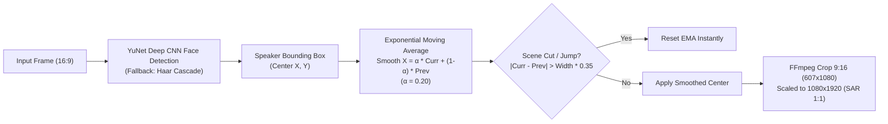

# Active Speaker Face Tracking & Subtitle Styling Engine

Technical reference for dynamic 9:16 portrait subject framing and ASS subtitle rendering.

---

## 1. Active Speaker Facial Framing Architecture

Widescreen 16:9 video often places human subjects off-center. Simply cropping the center leaves speakers partially cut off. The `active_speaker` layout mode dynamically centers subjects:



### Smoothing & Jump Prevention
- **Smoothing Factor ($\alpha=0.20$):** Smooths natural head gestures and small posture shifts without camera jitter.
- **Scene-Cut Reset:** When a camera switches angles or shot cuts occur (detected when the subject position jumps by $> 35\%$ of frame width), the smoother resets immediately to avoid artificial camera drifting across scene cuts.

---

## 2. Dynamic Subtitle Presets Engine

The subtitle engine renders word-level highlight animations into Advanced SubStation Alpha (`.ass`) scripts burned directly by FFmpeg:

| Preset Name | Target Platform / Aesthetic | Font & Typography | Color Palette | Animation Style |
| :--- | :--- | :--- | :--- | :--- |
| **`hormozi`** | Viral Shorts, TikTok, Reels | Bold Heavy Uppercase (`Montserrat / Arial Black`) | Bright Yellow (`&H0000FFFF&`) active word, Crisp White text, Black Outline (`&H00000000&`) | Word-by-word active pop highlight. |
| **`beast_bounce`** | MrBeast Style High Energy | Heavy Sans-Serif | Bright Lime Green (`&H0000FF00&`), Thick Black Border | Subtle font scale-up on active word. |
| **`neon_cyber`** | Tech, Gaming, AI, Cyberpunk | Modern Geometric Sans | Bright Cyan (`&H00FFFF00&`) with Magenta drop shadow | Glow luminescence outline. |
| **`karaoke_gold`** | Podcasts, Narration | Serif or Clean Medium Sans | Deep Gold (`&H0000D7FF&`) | Progressive fill across spoken words. |
| **`bold_social`** | Educational & Documentary | Clean Minimalist | Solid White (`&H00FFFFFF&`), Deep Shadow | High-legibility subtle bounce. |

### Centisecond Timestamp Calculation
YouTube transcripts and Whisper timestamps operate on floating-point seconds. The subtitle compiler converts these deterministically into standard ASS centisecond format (`H:MM:SS.cc`):

$$\text{Hours} = \lfloor t / 3600 \rfloor, \quad \text{Mins} = \lfloor (t \bmod 3600) / 60 \rfloor, \quad \text{Secs} = \lfloor t \bmod 60 \rfloor, \quad \text{Centis} = \lfloor (t - \lfloor t \rfloor) \times 100 \rfloor$$

Carries are clamped to prevent illegal representations like `00:01:59.100`.

---

## 3. FFmpeg Video Filtergraphs

### `blur_background` Filtergraph
```bash
-filter_complex "[0:v]split=2[bg_src][fg_src]; \
[bg_src]scale=1080:1920:force_original_aspect_ratio=increase,crop=1080:1920,boxblur=25:5[bg]; \
[fg_src]scale=1080:-2,setsar=1[fg]; \
[bg][fg]overlay=(W-w)/2:(H-h)/2,setsar=1[v]"
```

### `crop_center` Filtergraph
```bash
-filter_complex "[0:v]crop=ih*9/16:ih:(iw-ih*9/16)/2:0,scale=1080:1920,setsar=1[v]"
```

### `active_speaker` Filtergraph
```bash
-filter_complex "[0:v]crop=ih*9/16:ih:{crop_x}:0,scale=1080:1920,setsar=1[v]"
```
