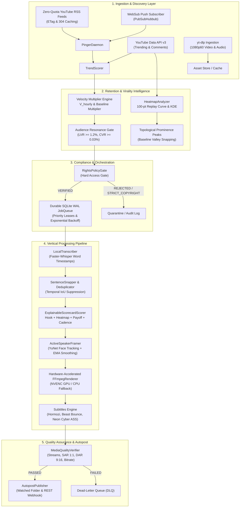
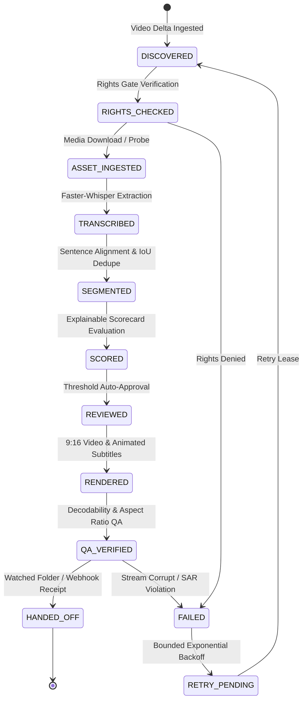

# YouTube Clipping Intelligence Platform - System Architecture

Comprehensive architectural specification for the autonomous YouTube clipping, audience retention intelligence, and vertical short-form production platform.

---

## 1. High-Level Architectural Topology

---

## 2. Pipeline State Machine & Checkpointing

Every job transitions through discrete, atomic stages persisted in SQLite (`data/jobs.db`). A worker crash or restart allows immediate recovery from the latest verified checkpoint without re-transcribing or re-rendering:

---

## 3. Database Schema Specifications

The storage layer relies on SQLite running in Write-Ahead Logging (`WAL`) mode with foreign key enforcement and synchronous normal pragmas for maximum throughput and zero corruption.

### Monitored Channels (`monitored_channels`)
| Column | Type | Description |
| :--- | :--- | :--- |
| `channel_id` | `TEXT PRIMARY KEY` | Canonical YouTube channel identifier (`UC...`). |
| `name` | `TEXT NOT NULL` | Creator name or display title. |
| `channel_url` | `TEXT NOT NULL` | Public YouTube channel URL. |
| `handle` | `TEXT` | Creator `@handle`. |
| `baseline_views` | `REAL DEFAULT 10000.0`| 30-day historical average view benchmark. |
| `active` | `INTEGER DEFAULT 1` | Active monitoring status flag (1=active, 0=inactive). |
| `paused` | `INTEGER DEFAULT 0` | Pause flag for temporary monitoring suspension. |
| `etag` | `TEXT` | HTTP ETag header cached from last RSS fetch. |
| `last_modified` | `TEXT` | HTTP `Last-Modified` timestamp cached from last RSS fetch. |
| `clipping_policy` | `TEXT DEFAULT 'OPEN_AFFILIATE'`| Licensing policy (`OPEN_AFFILIATE`, `CREATIVE_COMMONS`, etc.). |
| `last_polled_at` | `TEXT` | ISO 8601 timestamp of most recent poll. |
| `created_at` | `TEXT NOT NULL` | Registration timestamp. |

### Discovered Uploads (`discovered_uploads`)
| Column | Type | Description |
| :--- | :--- | :--- |
| `video_id` | `TEXT PRIMARY KEY` | Unique 11-character YouTube video ID. |
| `channel_id` | `TEXT NOT NULL` | Foreign key referencing `monitored_channels(channel_id)`. |
| `title` | `TEXT NOT NULL` | Video title (UTF-8 / emoji safe). |
| `published_at` | `TEXT NOT NULL` | Official video publish timestamp. |
| `discovered_at` | `TEXT NOT NULL` | Detection timestamp. |
| `initial_views` | `INTEGER DEFAULT 0` | View count recorded at discovery. |
| `latest_views` | `INTEGER DEFAULT 0` | Current view count. |
| `hourly_velocity` | `REAL DEFAULT 0.0` | Calculated views per hour ($V_{\text{hourly}}$). |
| `velocity_multiplier`| `REAL DEFAULT 0.0` | Velocity compared against baseline ($M_v$). |
| `virality_classification`| `TEXT DEFAULT 'STEADY'`| Classification (`VIRAL_EXPLOSION`, `TRENDING_HIGH`, etc.). |
| `like_ratio` | `REAL DEFAULT 0.0` | Like-to-View Ratio (LVR %). |
| `comment_ratio` | `REAL DEFAULT 0.0` | Comment-to-View Ratio (CVR %). |
| `status` | `TEXT DEFAULT 'DISCOVERED'`| Processing status (`DISCOVERED`, `ANALYZED`, `QUEUED`). |
| `attribution_text` | `TEXT` | Pre-rendered attribution caption with creator handle. |
| `source_url` | `TEXT` | Canonical `https://youtu.be/{video_id}` URL. |
| `created_at` | `TEXT NOT NULL` | Record creation timestamp. |

### Velocity Snapshots (`velocity_snapshots`)
| Column | Type | Description |
| :--- | :--- | :--- |
| `snapshot_id` | `INTEGER PRIMARY KEY AUTOINCREMENT` | Auto-incrementing identifier. |
| `video_id` | `TEXT NOT NULL` | Video identifier. |
| `channel_id` | `TEXT NOT NULL` | Channel identifier. |
| `views` | `INTEGER NOT NULL` | Snapshot view count. |
| `likes` | `INTEGER DEFAULT 0` | Snapshot like count. |
| `comments` | `INTEGER DEFAULT 0` | Snapshot comment count. |
| `hourly_velocity` | `REAL NOT NULL` | Hourly velocity at snapshot time. |
| `velocity_multiplier`| `REAL NOT NULL` | Velocity multiplier at snapshot time. |
| `age_hours` | `REAL NOT NULL` | Video age in hours at snapshot time. |
| `classification` | `TEXT NOT NULL` | Assigned virality category. |
| `recorded_at` | `TEXT NOT NULL` | Snapshot timestamp. |
| `source` | `TEXT DEFAULT 'rss_pinger'` | Ingestion source identifier. |

### Creator Permissions (`creator_permissions`)
| Column | Type | Description |
| :--- | :--- | :--- |
| `channel_id` | `TEXT PRIMARY KEY` | Channel ID or handle. |
| `channel_name` | `TEXT NOT NULL` | Creator name. |
| `policy_type` | `TEXT DEFAULT 'OPEN_AFFILIATE'`| Licensing policy rule. |
| `attribution_template`| `TEXT` | Custom attribution template string. |
| `allowed_commercial`| `INTEGER DEFAULT 1` | Commercial use authorization flag. |
| `requires_approval` | `INTEGER DEFAULT 0` | Human manual review flag. |
| `notes` | `TEXT` | Legal compliance audit notes. |
| `updated_at` | `TEXT NOT NULL` | Last update timestamp. |

---

## 4. Canonical Idempotency

Duplicate publishing is strictly prevented using a SHA-256 idempotency key generated from deterministic parameters rounded to 3 fixed decimal places:

$$\text{Key} = \text{SHA256}\left(\text{video\_id} : \text{start\_seconds}_{.3f} : \text{end\_seconds}_{.3f} : \text{rights\_id}\right)$$

Any attempt to re-render or re-publish an identical temporal highlight interval is rejected before media encoding begins.
