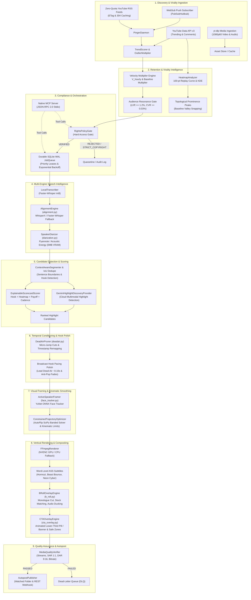
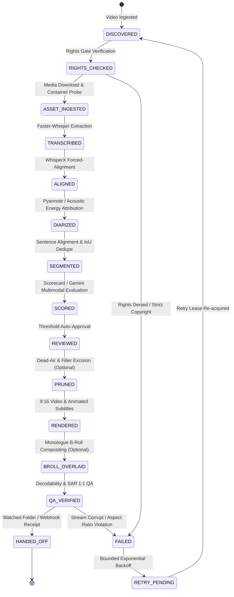

# YouTube Clipping Intelligence Platform — System Architecture

Comprehensive architectural specification for the autonomous YouTube clipping, audience retention intelligence, multimodal highlight discovery, and vertical short-form production platform.

---

## 1. High-Level Architectural Topology



---

## 2. End-to-End Data Flow Specification

The processing lifecycle follows a deterministic, 10-stage sequential pipeline with hard validation boundaries at each junction:

```text
[ Discovery ] ──► [ Rights Gate ] ──► [ Ingestion ] ──► [ Speech Transcribe / Align / Diarize ]
      │
      ▼
[ Highlight Detection & Scoring ] ──► [ Dead-Air Pruning & Hook Polish ] ──► [ Kinematic Viewport Optimization ]
      │
      ▼
[ 9:16 FFmpeg Rendering ] ──► [ B-Roll & CTA Overlay ] ──► [ QA Verification ] ──► [ Autopost ]
```

1. **Discovery & Virality Scoring:**
   - Ingestion daemon continuously checks creator channels via zero-quota public Atom feeds (`ETag` and HTTP 304 caching).
   - Computes early-hour velocity $V_{\text{hourly}} = \frac{\text{views}}{\max(\text{age}, 0.25)}$ and baseline multiplier $M_v$.
   - Enforces the Audience Resonance Gate (Like-to-View Ratio $\ge 1.2\%$, Comment-to-View Ratio $\ge 0.03\%$).
   - Calculates crowd-sourced replay prominence using the 100-point YouTube heatmap or Gaussian KDE comment density.

2. **Rights & Legal Governance:**
   - Enforces a hard, non-bypassable verification gate against the transactional SQLite ledger (`LocalRightsPolicy`).
   - Rejects unverified content and immediately quarantines creators with `STRICT_COPYRIGHT` policies.

3. **Multi-Engine Speech Processing:**
   - Transcribes full-length audio via `LocalTranscriber` utilizing `Faster-Whisper` running int8 quantization locally.
   - Refines word boundaries with `AlignmentEngine` (`transcription/alignment.py`), employing `WhisperX` phoneme-level forced alignment when CUDA dependencies exist, or falling back seamlessly to monotonic word boundary clamping (`FasterWhisperAlignmentAdapter`).
   - Performs speaker diarization with `SpeakerDiarizer` (`podcast/diarization.py`), employing `PyannoteDiarizerAdapter` when available, or instantly degrading to `AcousticEnergyDiarizer` (pure NumPy/SciPy audio energy and spectral clustering requiring 0MB VRAM).

4. **Candidate Detection & Scoring (Dual Intelligence):**
   - Candidate intervals ($15\text{s} - 60\text{s}$) are generated by `ContextAwareSegmenter` along natural grammatical sentence boundaries.
   - Evaluated by either:
     - **Local Heuristic Intelligence:** `ExplainableScorecardScorer` computes composite virality scores factoring Hook Strength (25%), Heatmap Peak Alignment (25%), Narrative Flow (20%), Cadence/Pacing (15%), and Virality Boost (15%).
     - **Cloud Multimodal Intelligence:** `GeminiHighlightDiscoveryProvider` (`scoring/gemini_provider.py`) sends formatted transcripts and retention curves to Gemini 1.5 Flash to extract high-hook, standalone-viable clips without consuming local VRAM.
   - Evaluates loop hook continuity via `ShortViabilityValidator` and populates `loop_affinity_score`.
   - Temporal Non-Maximum Suppression (`suppress_overlapping_candidates`) removes overlapping clips exceeding $50\%$ temporal Intersection over Union (IoU).

5. **Temporal Conditioning & Hook Pacing Polish:**
   - When enabled, `DeadAirPruner` detects audio pauses ($>0.5\text{s}$) and standalone conversational fillers ("um", "uh", "like").
   - Broadcast hook pacing polish trims leading silence $>0.15\text{s}$ down to exactly $\text{first\_word.start} - 0.10\text{s}$, preventing awkward dead-air pauses while preserving initial breathing and plosive consonants.
   - Protects outro boundaries against clipping spoken words mid-syllable.

6. **Camera Trajectory Optimization:**
   - `ActiveSpeakerFramer` detects human faces per frame using OpenCV YuNet ONNX deep CNN.
   - Feeds raw face center coordinates to `ConstrainedTrajectoryOptimizer` (`rendering/face_tracker.py`), which executes a banded SciPy linear system solve enforcing maximum panning velocity ($\le 450\text{ px/s}$), acceleration ramps ($\le 750\text{ px/s}^2$), and a $24\text{ px}$ micro-jitter deadband.
   - Detects shot angle cuts ($>35\%$ width jumps) to instantly reset camera anchors and eliminate visual whip-pans.

7. **Vertical 9:16 Video Rendering:**
   - `FFmpegRenderer` builds dynamic filtergraphs for four layout modes: `blur_background` (blurred 16:9 canvas), `active_speaker` (dynamic kinematic crop), `crop_center` (static 9:16), or `split_screen` (dual stacked 9:8 viewports for podcasts).
   - Injects broadcast audio anti-pop fades (20ms half-sine `afade=t=in:ss=0:d=0.02:curve=hsin` and 250ms outro fade-out) and subtle video fades to eliminate harsh digital clicks.
   - Burns word-level kinetic ASS subtitles styled according to aesthetic presets (`hormozi`, `beast_bounce`, `neon_cyber`, `karaoke_gold`, `bold_social`).
   - Employs NVIDIA NVENC hardware acceleration (`h264_nvenc`) with constant quality (`-cq 22`), automatically degrading to CPU `libx264`.

8. **Automated B-Roll Stock & Call-to-Action (CTA) Overlay:**
   - When enabled, `BRollOverlayEngine` (`rendering/b_roll.py`) inspects word timestamps to detect unbroken monologue intervals ($\ge 4.0\text{ s}$) and overlays contextual footage with $0.4\times$ audio ducking.
   - `CTAOverlayEngine` (`rendering/cta_overlay.py`) renders lower-third animated call-to-action pills/banners with mobile safe-zone awareness (avoiding TikTok/Reels UI buttons and podcast center dividers).

9. **Quality Assurance (QA) Verification:**
   - `MediaQualityVerifier` validates the final MP4 container decodability, Sample Aspect Ratio (SAR 1:1), Display Aspect Ratio (DAR 9:16), duration bounds, and audio/video stream integrity.
   - Generates a cryptographic SHA-256 fingerprint for canonical artifact provenance.

10. **Autopost Delivery:**
    - `DualModeAutopostPublisher` delivers verified clips to monitored inbox folders or triggers REST webhooks with delivery receipts and transactional idempotency enforcement.

---

## 3. Subsystem Architecture Deep-Dives

### A. Forced-Alignment Subsystem (`src/yt_clipping/transcription/alignment.py`)
- **Protocol:** `AlignmentEngine` Abstract Base Class defining `align_words(audio_path, transcript, **kwargs) -> TranscriptData`.
- **Implementations:**
  - `WhisperXAlignmentAdapter`: Loads Wav2Vec2 alignment models to compute phoneme-level cross-correlation matrices between audio frames and recognized characters.
  - `FasterWhisperAlignmentAdapter`: Pure-Python monotonic validator that guarantees:
    1. Word start timestamps are non-negative ($t_{\text{start}} \ge 0.0$).
    2. Words are strictly ordered monotonically ($t_{\text{start}, i} \ge t_{\text{end}, i-1}$).
    3. Inverted timestamps ($t_{\text{end}} < t_{\text{start}}$) are automatically flipped and normalized.
    4. Enforces minimum word duration threshold ($40\text{ ms}$).
    5. Resolves temporal overlaps by advancing subsequent start bounds.
- **Factory:** `create_alignment_engine(engine_type="auto")` cascades from WhisperX to faster-whisper.

### B. Audio Speaker Diarization Subsystem (`src/yt_clipping/podcast/diarization.py`)
- **Protocol:** `SpeakerDiarizer` Abstract Base Class with `diarize(audio_path, num_speakers, min_turn_duration) -> List[SpeakerTurn]` and `attribute_words_to_speakers(turns, words) -> List[WordTimestamp]`.
- **Implementations:**
  - `AcousticEnergyDiarizer`: Zero-VRAM offline engine. Extracts 16kHz mono PCM via FFmpeg, computes frame-level Root Mean Square (RMS) energy, estimates fundamental pitch via autocorrelation, and clusters speaker turns via energy distributions.
  - `PyannoteDiarizerAdapter`: Neural speaker clustering pipeline utilizing `pyannote.audio` models. Features automated exception handling that falls back to `AcousticEnergyDiarizer` if Hugging Face authentication or PyTorch dependencies are unavailable.

### C. Cloud Multimodal Highlight Provider (`src/yt_clipping/scoring/gemini_provider.py`)
- **Protocol:** Implements both `HighlightDetector` and `HighlightScorer` interfaces with `is_available()` health check.
- **Engine:** Google Gemini 1.5 Flash via REST API endpoint with zero local VRAM usage.
- **Guardrails:**
  - Enforces clip duration bounds ($15\text{s} - 60\text{s}$).
  - Strictly requires complete sentence boundaries and penalizes dangling conjunctions.
  - Purges sponsored commercial reads (NordVPN, AG1, BetterHelp).
  - Gracefully falls back to local `ContextAwareSegmenter` and `ExplainableScorecardScorer` when `GEMINI_API_KEY` is omitted or API calls fail.

### D. Kinematic Camera Trajectory Smoothing (`src/yt_clipping/rendering/face_tracker.py`)
- **Class:** `ConstrainedTrajectoryOptimizer` (AutoFlip-inspired).
- **Mathematical Formulation:**
  Optimizes camera horizontal center coordinate $x(t)$ over time $t$ by minimizing the objective function:
  $$\min_x \sum_{t} w_t (x_t - c_t)^2 + \lambda_v \sum_{t} (x_{t+1} - x_t)^2 + \lambda_a \sum_{t} (x_{t+1} - 2x_t + x_{t-1})^2$$
  Subject to:
  $$\frac{W_{\text{crop}}}{2} \le x_t \le W_{\text{canvas}} - \frac{W_{\text{crop}}}{2}$$
  $$\left|\frac{x_{t+1} - x_t}{\Delta t}\right| \le V_{\text{max}} \quad (450 \text{ px/s})$$
  $$\left|\frac{x_{t+1} - 2x_t + x_{t-1}}{\Delta t^2}\right| \le A_{\text{max}} \quad (750 \text{ px/s}^2)$$
- **Robustness:** Input injection sanitized to handle non-numeric strings, `NaN`, and `inf` values gracefully.
- **Solver Architecture:** Employs `scipy.linalg.solveh_banded` for $O(N)$ linear-time banded matrix decomposition, with automatic fallback to a dense NumPy Cholesky solver or pure-Python kinematic limiter if SciPy is uninstalled.

### E. Automated B-Roll Overlay Engine (`src/yt_clipping/rendering/b_roll.py`)
- **Class:** `BRollOverlayEngine`.
- **Pipeline:**
  1. Monologue Speech Analysis: Scans word timestamps for continuous speech runs $\ge 4.0\text{ s}$ without inter-word pauses $>0.5\text{ s}$.
  2. Keyword Filtering: Extracts substantive nouns and verbs while stripping conversational stop words, filler words, and buzzwords.
  3. Stock Asset Resolution: Matches extracted keywords against filenames and tags in the local B-roll asset directory.
  4. Filtergraph Assembly: Builds complex FFmpeg filter expressions incorporating $0.25\text{ s}$ alpha fades, proportional center-crop scaling to 1080x1920, and audio mixing with $0.4\times$ dialogue ducking.

### F. Native Model Context Protocol (MCP) Server (`src/yt_clipping/mcp/server.py`)
- **Protocol:** Model Context Protocol (MCP) `2024-11-05` standard JSON-RPC 2.0 stdio server.
- **Stream Isolation:** Diagnostic logging is routed strictly to `stderr`, preserving `stdout` exclusively for well-formed JSON-RPC frames.
- **Tool Catalog (6 + 1 Tools):**
  1. `discover_channel_uploads`: Ingests recent uploads from RSS feeds or channel cache.
  2. `verify_source_rights`: Validates licensing and compliance against the SQLite rights ledger.
  3. `analyze_replay_heatmap`: Extracts 100-point replay curves and prominence peaks.
  4. `evaluate_highlight_candidates`: Scores highlights using local heuristics or Gemini Flash.
  5. `render_vertical_clip`: Renders 9:16 short clips with custom layouts and animated subtitles.
  6. `inspect_job_status`: Queries execution progress and QA telemetry from SQLite.
  7. `list_available_tools` / `tools/list`: Returns JSON schemas for all exposed capabilities.

### G. Animated Call-to-Action (CTA) Overlay Engine (`src/yt_clipping/rendering/cta_overlay.py`)
- **Class:** `CTAOverlayEngine`.
- **Config & Enums:** `CTAConfig`, `CTAStyle` (`MODERN_PILL`, `NEON_BANNER`, `MINIMAL`), `CTATiming` (`END`, `INTRO`, `PERSISTENT`), `CTATimingWindow`.
- **Safe-Zone Geometry:**
  - Dynamic viewport coordinate calculations avoiding TikTok/Reels UI overlay obstructions ($Y \in [1440, 1560]$ for vertical 9:16).
  - Split-screen podcast awareness: adjusts Y coordinates to clear the center horizontal divider ($Y \approx 960$).
- **Dual-Path Rendering:**
  1. *Libass ASS Subtitle Injection:* Injects vector rounded-rectangle background pills (`m ... b ... c ...`) and formatted text directly into the subtitle dialogue stream with `\move` smooth slide-up and `\fad` alpha fade-in/out transitions.
  2. *Native FFmpeg Filtergraph:* Generates parameterized `drawbox` and `drawtext` filter chains with `enable='between(t,...)'` and alpha curves when rendering without ASS subtitles.

### H. Broadcast Hook Pacing & Audio Anti-Pop Polish
- **Pacing Engine:** Integrated into `ClippingPipeline` (Stage 6b) and `FFmpegRenderer`.
- **Leading Dead-Air Excision:** Trims pre-speech pause down to $0.10\text{ s}$ if leading silence exceeds $0.15\text{ s}$, preserving natural inhalation headroom and plosive consonants while eliminating boring dead-air.
- **Word Boundary Protection:** Protects clip start/end boundaries against mid-syllable cuts by evaluating word alignment confidence and extending boundaries to the nearest complete word boundary.
- **Micro-Fade Audio Transitions:** Injects a microscopic $20\text{ ms}$ half-sine audio fade-in (`afade=t=in:ss=0:d=0.02:curve=hsin`) and $250\text{ ms}$ outro fade-out (`afade=t=out:d=0.25:curve=hsin`) into FFmpeg commands, eliminating speaker pops, audio clicks, and harsh digital clipping.
- **Loop Continuity Scoring:** Integrates `ShortViabilityValidator.evaluate_viability().loop_hook_score` into `HighlightCandidate.loop_affinity_score` ($0.0 - 10.0$) and manifests for instant creator loop assessment.

---

## 4. Pipeline State Machine & Checkpointing

Every job transitions through discrete, atomic stages persisted in the SQLite WAL journal (`data/jobs.db`). A worker crash or restart allows immediate resumption from the latest verified checkpoint without re-transcribing or re-rendering:



---

## 5. Storage Layer & Database Schema

The persistence layer uses SQLite configured with Write-Ahead Logging (`WAL`), foreign key enforcement, and synchronous normal pragmas.

### Monitored Channels (`monitored_channels`)
| Column | Type | Description |
| :--- | :--- | :--- |
| `channel_id` | `TEXT PRIMARY KEY` | Canonical YouTube channel identifier (`UC...`). |
| `name` | `TEXT NOT NULL` | Creator name or display title. |
| `channel_url` | `TEXT NOT NULL` | Public YouTube channel URL. |
| `handle` | `TEXT` | Creator `@handle`. |
| `baseline_views` | `REAL DEFAULT 10000.0`| 30-day historical average view benchmark. |
| `active` | `INTEGER DEFAULT 1` | Active monitoring status flag (1=active, 0=inactive). |
| `paused` | `INTEGER DEFAULT 0` | Temporary monitoring pause flag. |
| `etag` | `TEXT` | HTTP ETag header cached from last RSS fetch. |
| `last_modified` | `TEXT` | HTTP `Last-Modified` timestamp cached from last RSS fetch. |
| `clipping_policy` | `TEXT DEFAULT 'OPEN_AFFILIATE'`| Licensing policy rule. |
| `last_polled_at` | `TEXT` | ISO 8601 timestamp of most recent poll. |
| `created_at` | `TEXT NOT NULL` | Registration timestamp. |

### Discovered Uploads (`discovered_uploads`)
| Column | Type | Description |
| :--- | :--- | :--- |
| `video_id` | `TEXT PRIMARY KEY` | Unique 11-character YouTube video ID. |
| `channel_id` | `TEXT NOT NULL` | Foreign key referencing `monitored_channels(channel_id)`. |
| `title` | `TEXT NOT NULL` | Video title (UTF-8 safe). |
| `published_at` | `TEXT NOT NULL` | Video publication timestamp. |
| `discovered_at` | `TEXT NOT NULL` | Discovery timestamp. |
| `initial_views` | `INTEGER DEFAULT 0` | View count recorded at discovery. |
| `latest_views` | `INTEGER DEFAULT 0` | Most recent view count. |
| `hourly_velocity` | `REAL DEFAULT 0.0` | Views per hour ($V_{\text{hourly}}$). |
| `velocity_multiplier`| `REAL DEFAULT 0.0` | Velocity compared against baseline ($M_v$). |
| `virality_classification`| `TEXT DEFAULT 'STEADY'`| Assigned category (`VIRAL_EXPLOSION`, etc.). |
| `like_ratio` | `REAL DEFAULT 0.0` | Like-to-View Ratio (LVR %). |
| `comment_ratio` | `REAL DEFAULT 0.0` | Comment-to-View Ratio (CVR %). |
| `status` | `TEXT DEFAULT 'DISCOVERED'`| Pipeline status (`DISCOVERED`, `ANALYZED`, `QUEUED`). |
| `attribution_text` | `TEXT` | Pre-rendered attribution caption. |
| `source_url` | `TEXT` | Canonical `https://youtu.be/{video_id}` URL. |
| `created_at` | `TEXT NOT NULL` | Record creation timestamp. |

### Pipeline Job Journal (`job_journal`)
| Column | Type | Description |
| :--- | :--- | :--- |
| `job_id` | `TEXT PRIMARY KEY` | Unique job identifier (`job-xyz-123`). |
| `video_id` | `TEXT NOT NULL` | Foreign key referencing `discovered_uploads(video_id)`. |
| `current_stage` | `TEXT NOT NULL` | Stage (`DISCOVERED`, `TRANSCRIBED`, `RENDERED`, etc.). |
| `status` | `TEXT NOT NULL` | Status (`PENDING`, `RUNNING`, `SUCCEEDED`, `FAILED`). |
| `retry_count` | `INTEGER DEFAULT 0` | Bounded retry attempts. |
| `max_retries` | `INTEGER DEFAULT 3` | Maximum retry threshold before moving to DLQ. |
| `checkpoints` | `TEXT` | JSON-encoded stage checkpoint telemetry. |
| `error_message` | `TEXT` | Last recorded exception or error stack trace. |
| `created_at` | `TEXT NOT NULL` | Job creation timestamp. |
| `updated_at` | `TEXT NOT NULL` | Last stage transition timestamp. |

---

## 6. Canonical Idempotency & Resource Governance

### SHA-256 Idempotency Key
Duplicate rendering and multi-platform publishing are strictly prevented via a deterministic SHA-256 idempotency key:
$$\text{Key} = \text{SHA256}\left(\text{video\_id} : \text{start\_seconds}_{.3f} : \text{end\_seconds}_{.3f} : \text{layout\_mode} : \text{rights\_id}\right)$$
Any attempt to re-render or re-publish an identical clip configuration is short-circuited before launching FFmpeg.

### Storage Quota Governance
- `StorageManager` actively tracks asset cache directories (`data/assets`, `data/transcripts`, `data/heatmaps`, `data/rendered_clips`).
- Enforces Least Recently Used (LRU) pruning whenever disk usage crosses configured thresholds ($85\%$ soft cap, $95\%$ hard cap).
- Intermediate raw WAV and video files are safely deleted once the final composited MP4 artifact is verified and fingerprinted.

---

## 7. Related Documentation & Technical Deep-Dives

- **[System Mental Map & Reference Architecture](SYSTEM_MENTAL_MAP.md):** Architectural mental models, directory topology, and CLI argument-to-pipeline traceability matrix.
- **[Master Documentation Portal](README.md):** Complete index of all technical documentation.
- **[Podcast Engine Specification](PODCAST_ENGINE.md):** 9:8 stacked split-screen, diarization, and shot detection.
- **[Model Context Protocol (MCP) Specification](mcp.md):** JSON-RPC 2.0 tool definitions and LLM orchestration.
- **[CLI Operator Reference](CLI_REFERENCE.md):** Complete manual of subcommands and environment flags.
- **[Module & API Directory](MODULE_REFERENCE.md):** Exhaustive Python subsystem API catalog.
- **[Virality & Attribution Policy](VIRALITY_AND_ATTRIBUTION.md):** Velocity multipliers and creator rights ledger.
- **[Active Speaker & Kinetic Captions](ACTIVE_SPEAKER_AND_CAPTIONS.md):** YuNet tracking and ASS subtitle animation presets.
- **[Release Readiness Report](RELEASE_READINESS_REPORT.md):** Hardware verification, VRAM profiling, and certification.
- **[Comprehensive Test Report](COMPREHENSIVE_TEST_REPORT.md):** 381-test execution audit and adversarial matrix.
