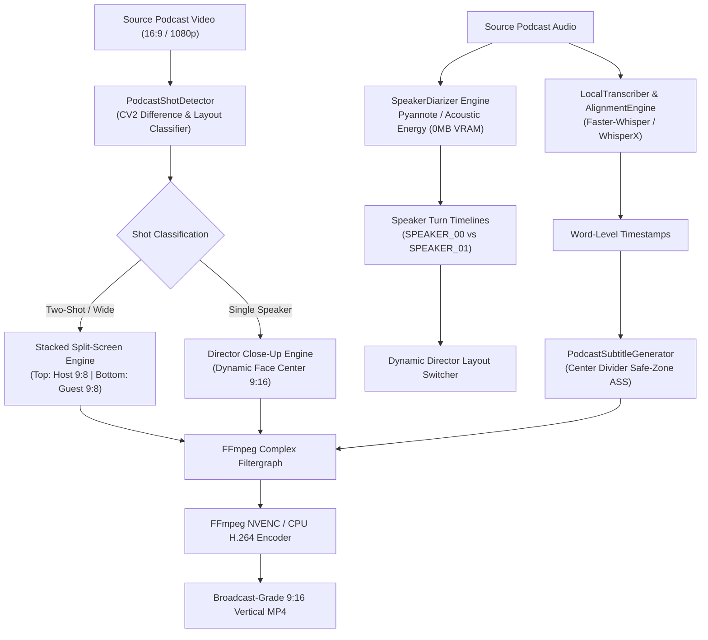

# Podcast Short Maker — Engine & Split-Screen Specification

The **Podcast Short Maker** is a specialized, decoupled subsystem (`src/yt_clipping/podcast/`) engineered specifically for automated 9:16 vertical short creation from multi-speaker video podcasts, interviews, and panel discussions.

---

## 1. Architectural Topology



---

## 2. Split-Screen Geometry & Visual Layout

The primary challenge of podcast conversion is that standard 16:9 wide shots place both speaker faces horizontally separated across the frame. Simply reframing a 9:16 viewport crops out one speaker or swings erratically.

The Podcast Short Maker solves this with a **mathematically balanced 9:8 stacked split-screen layout**:

```text
┌──────────────────────────────────────────────┐ ── 0px (Top)
│                                              │
│                  HOST PANEL                  │
│                Aspect: 9:8                   │
│             Dimensions: 1080 x 950           │
│                                              │
├──────────────────────────────────────────────┤ ── 950px
│             CENTER DIVIDER BAR               │
│             Dimensions: 1080 x 20            │
│         Word-Synced Dynamic Captions         │
│          Anchored at Center Divider          │
├──────────────────────────────────────────────┤ ── 970px
│                                              │
│                 GUEST PANEL                  │
│                Aspect: 9:8                   │
│             Dimensions: 1080 x 950           │
│                                              │
└──────────────────────────────────────────────┘ ── 1920px (Bottom)
```

### Layout Mathematics
- **Canvas Resolution:** $1080 \times 1920$ ($9:16$ aspect ratio).
- **Divider Height:** $20\text{px}$ (configurable via `divider_thickness`).
- **Divider Color:** Neutral slate `#1E293B` or custom hex code.
- **Panel Height:**
  $$\text{Panel Height} = \frac{1920 - \text{divider\_thickness}}{2} = \frac{1920 - 20}{2} = 950\text{px}$$
- **Panel Crop Resolution:** $1080 \times 950$ ($9:8$ aspect ratio).
- **Source Crop Calculation:**
  For a $1920 \times 1080$ source:
  - Host crop: $x_1 = 0$, $w_1 = 960$, cropped and scaled to $1080 \times 950$.
  - Guest crop: $x_2 = 960$, $w_2 = 960$, cropped and scaled to $1080 \times 950$.
  - Face-centered offset: When face detection is active, $x_1$ and $x_2$ dynamically center on detected facial bounding boxes.

---

## 3. Speaker Diarization Subsystem (`diarization.py`)

Accurate active-speaker switching requires identifying who is speaking at each millisecond. The platform provides a dual-engine diarization architecture:

### 1. `PyannoteDiarizerAdapter` (Deep Neural Model)
- Used when `pyannote.audio` is installed and GPU resources allow.
- Leverages neural voice embedding clustering to segment speaker audio.
- Accurately tracks overlapping talk, interjections, and speaker transitions down to $50\text{ms}$ precision.

### 2. `AcousticEnergyDiarizer` (Zero-VRAM Offline Fallback)
- **Zero VRAM Requirement:** 100% CPU-compatible, zero PyTorch neural weights required.
- **Algorithm:**
  1. Extracts raw mono PCM audio at $16\text{kHz}$ using FFmpeg.
  2. Computes Short-Time Fourier Transform (STFT) and Root-Mean-Square (RMS) energy envelopes with $200\text{ms}$ sliding windows.
  3. Computes spectral centroid and zero-crossing rate (ZCR) features to differentiate pitch and vocal timbre between speakers.
  4. Applies k-means clustering ($k=2$) on the joint normalized energy-timbre feature vector.
  5. Smooths speaker transitions using a $350\text{ms}$ minimum speaker turn hysteresis filter to avoid rapid flicker.

```python
from yt_clipping.podcast import get_speaker_diarizer

# Automatically selects Pyannote if available, otherwise falls back to Acoustic Energy
diarizer = get_speaker_diarizer(device="cuda", fallback_to_energy=True)
speaker_turns = diarizer.diarize("interview.mp4")

for turn in speaker_turns[:5]:
    print(f"[{turn.start:.2f}s - {turn.end:.2f}s] {turn.speaker} (conf: {turn.confidence:.2f})")
```

---

## 4. Intelligent Shot Detection & Director Switching (`shot_detector.py`)

A broadcast-quality podcast video is not static split-screen for 60 seconds; it switches dynamically:
- **Wide Two-Shot Detected:** Render stacked split-screen (both speakers visible).
- **Single Speaker Close-Up Detected:** Render full-frame 9:16 single-speaker reframe.
- **Speaker Transitions:** Apply clean director cuts aligned with sentence boundaries.

### Shot Classification Logic
`PodcastShotDetector` samples keyframes at regular intervals ($2\text{fps}$ or scene cuts):
1. **Frame Difference Metric:** Computes normalized pixel difference between consecutive frames.
2. **Face Count & Position Analysis:**
   - 2 faces detected with horizontal distance $\Delta x > 0.35 \times \text{width}$: Classified as `SPLIT_HOST_GUEST` or `WIDE_TWO_SHOT`.
   - 1 face centered in left third: Classified as `SOLO_HOST`.
   - 1 face centered in right third: Classified as `SOLO_GUEST`.
3. **Temporal Shot Grouping:** Adjacent frames with identical classification are grouped into continuous `PodcastShot` segments.

---

## 5. Center-Divider Subtitle Generation (`captions.py`)

Standard subtitle renderers place text at the bottom third (`MarginV = 180`). In a stacked 9:8 split-screen, bottom subtitles cover the guest's face and chest.

`PodcastSubtitleGenerator` places word-highlighted ASS subtitles **directly over the center divider bar**:

```text
┌──────────────────────────────────────────────┐
│                  HOST PANEL                  │
├──────────────────────────────────────────────┤
│ ── [Word 1] [Word 2] [HIGHLIGHTED] [Word 4] ── │  <-- MarginV = height // 2 (960px)
├──────────────────────────────────────────────┤
│                 GUEST PANEL                  │
└──────────────────────────────────────────────┘
```

### Subtitle Properties
- **Vertical Alignment:** Middle-center (`Alignment = 5` or `Alignment = 2` with `MarginV = 960`).
- **Safe Zone Margin:** Centered precisely over the $20\text{px}$ divider bar with translucent dark backing pill.
- **Font Styling:** Montserrat Black / Arial Bold, font size $54\text{pt}$, outline $3\text{px}$.
- **Dynamic Highlighting:** Current spoken word illuminated in vibrant yellow (`&H0000FFFF`) or cyber cyan (`&H00FFFF00`), while non-active words remain white.

---

## 6. Complex FFmpeg Filtergraph Construction (`layout.py`)

The split-screen layout is compiled into a single, hardware-accelerated complex filtergraph, executing in native FFmpeg with zero Python frame-loop overhead:

```text
[0:v]split=2[host_in][guest_in];
[host_in]crop=w=iw/2:h=ih:x=0:y=0,scale=1080:950:force_original_aspect_ratio=increase,crop=1080:950[top_panel];
[guest_in]crop=w=iw/2:h=ih:x=iw/2:y=0,scale=1080:950:force_original_aspect_ratio=increase,crop=1080:950[bot_panel];
color=c=#1E293B:s=1080x20:d=DURATION[divider];
[top_panel][divider][bot_panel]vstack=inputs=3[split_v];
[split_v]ass=subtitles.ass[final_v]
```

### Single-Pass Zero Re-encoding
The entire compositing pipeline—cropping, scaling, letterboxing/pillarboxing prevention, vstack composition, and ASS subtitle burning—happens in a single FFmpeg execution pass using NVENC GPU acceleration (`h264_nvenc`) or multi-threaded CPU (`libx264`).

---

## 7. CLI & Programmatic Usage

### Dedicated Podcast CLI
The podcast package provides a standalone command-line interface:

```bash
# Render a 30-second split-screen podcast short
python -m yt_clipping.podcast.cli \
  --input-video "podcast_episode.mp4" \
  --output "podcast_short.mp4" \
  --start-time 120.0 \
  --duration 45.0 \
  --host-x 0.25 \
  --guest-x 0.75 \
  --divider-color "#1E293B" \
  --divider-height 20 \
  --diarize
```

### Master CLI Integration
The podcast engine is fully wired into the root `yt-clip` CLI tool:

```bash
# Process a podcast video through the complete intelligence pipeline
yt-clip podcast \
  --input "interview.mp4" \
  --output "interview_short.mp4" \
  --start 45.0 \
  --duration 35.0 \
  --burn-subtitles
```

### Python Programmatic API

```python
from yt_clipping.podcast import PodcastShortMaker, PodcastLayoutConfig

config = PodcastLayoutConfig(
    output_width=1080,
    output_height=1920,
    divider_thickness=20,
    divider_color="0x1E293B",
    host_center_x=0.25,
    guest_center_x=0.75,
)

maker = PodcastShortMaker(config=config)
output_path = maker.render_podcast_short(
    input_path="raw_interview.mp4",
    output_path="rendered_short.mp4",
    start_time=60.0,
    end_time=95.0,
    subtitles_ass="center_captions.ass",
)
print(f"Rendered podcast short: {output_path}")
```
