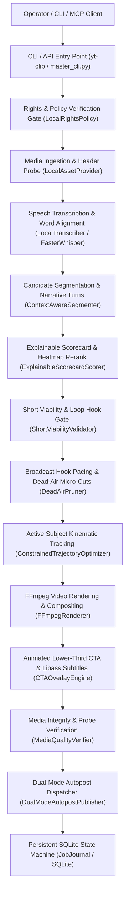
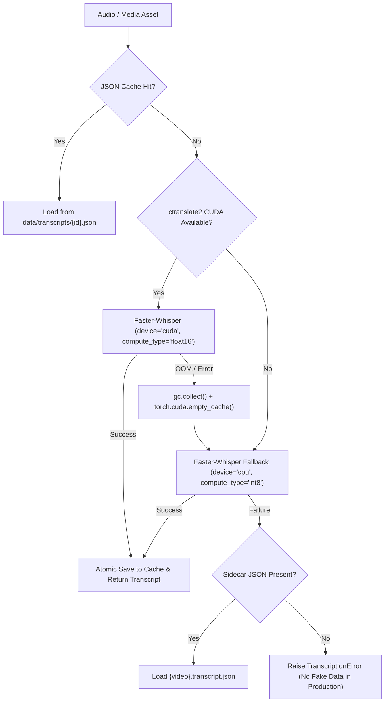
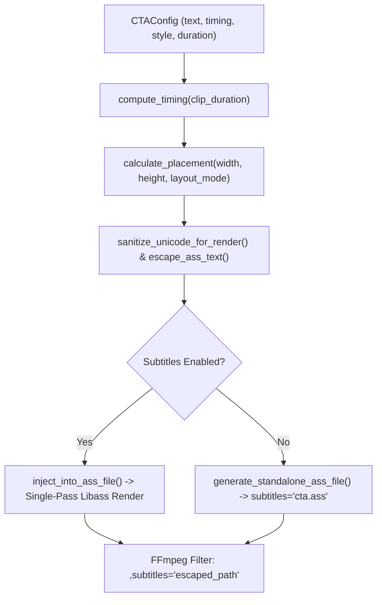

# YouTube Clipping Intelligence Platform - Permanent System Mental Map

## Architectural Reference, Execution Flow, and Call Hierarchy

---

## 1. Executive System Overview

The **YouTube Clipping Intelligence Platform (`yt-clipping-intelligence`)** is a production-grade, local-first intelligence and automated vertical clip generation pipeline. It autonomously discovers viral highlights, computes explainable multi-signal retention scores, trims dead air, synchronizes sub-second word timestamps, generates broadcast polish (hook onset, anti-pop fades, loop continuity), overlays self-contained animated Call-to-Action (CTA) lower-thirds, reframes widescreen footage into 9:16 vertical video using kinematic trajectory optimization, verifies media output integrity, and delivers clips via dual-mode autopost publishing.



---

## 2. Complete Repository Package Structure

```
yt-clipping-intelligence/
├── pyproject.toml                     # Project packaging, CLI entry points, dependencies
├── pytest.ini                         # Test runner configuration
├── data/                              # Local-first persistence directories
│   ├── assets/                        # Downloaded/ingested source video media
│   ├── jobs.db                        # SQLite transactional state & metric snapshot database
│   ├── heatmaps/                      # Local JSON cache for YouTube replay heatmaps
│   ├── transcripts/                   # Word-level timestamp JSON transcripts
│   ├── rendered_clips/                # Atomic final rendered vertical 9:16 MP4s and manifests
│   └── rights_ledger.json             # Cryptographically verified rights manifest ledger
├── docs/                              # Technical system documentation & ADRs
│   ├── ARCHITECTURE.md                # Subsystem architecture & design principles
│   ├── CLI_REFERENCE.md               # Operator CLI command handbook
│   ├── MODULE_REFERENCE.md            # Public API, class, and method index
│   ├── PODCAST_ENGINE.md              # Multi-speaker podcast diarization & split-screen docs
│   ├── SYSTEM_MENTAL_MAP.md           # This document (permanent architectural mental map)
│   └── mcp.md                         # Model Context Protocol stdio JSON-RPC 2.0 reference
├── src/yt_clipping/                   # Primary source codebase
│   ├── __init__.py                    # Top-level package version metadata
│   ├── config.py                      # Strongly-typed AppConfig and environment loader
│   ├── contracts/                     # Canonical domain interfaces and data models
│   │   ├── interfaces.py              # Abstract protocols (Transcriber, Renderer, Scorer, etc.)
│   │   └── models.py                  # Pydantic/dataclass contracts (RenderProfile, HighlightCandidate)
│   ├── audio/                         # Edge-TTS voiceover synthesis
│   │   └── tts_engine.py              # Local EdgeTTS voice generator
│   ├── cli/                           # CLI commands and argparsing
│   │   └── master_cli.py              # Master CLI parser (autoprobe, run, doctor, podcast, mcp)
│   ├── detection/                     # Segmentation, dead-air, and narrative turn analysis
│   │   ├── arc_detector.py            # Hook-anchored narrative arc detector
│   │   ├── audio_energy.py            # Acoustic RMS energy, motion, and cadence analyzer
│   │   ├── deadair.py                 # DeadAirPruner: micro-jump-cuts, filler word pruning
│   │   ├── dedupe.py                  # Highlight candidate overlap suppression
│   │   ├── segmenter.py               # ContextAwareSegmenter: boundary detection & punctuation split
│   │   ├── sentence_classifier.py     # Linguistic sentence classification
│   │   └── short_viability.py         # ShortViabilityValidator: Survives Without Context rule
│   ├── discovery/                     # YouTube intelligence, trend analysis, and channel monitoring
│   │   ├── attribution_engine.py      # Automated affiliate attribution generator
│   │   ├── channel_registry.py        # Creator channel metadata registry
│   │   ├── channel_watcher.py         # RSS / Atom feed polling watcher
│   │   ├── daemon.py                  # Multi-channel continuous background poll loop
│   │   ├── heatmap.py                 # HeatmapAnalyzer: YouTube replay curve & peak extraction
│   │   ├── monitor.py                 # Video candidate observation engine
│   │   ├── outlier.py                 # OutlierMultiplier: >=3.0x channel median breakout detection
│   │   ├── pinger_daemon.py           # High-velocity virality alert daemon
│   │   ├── quota_governor.py          # Daily YouTube API v3 quota tracker (10,000 units/day)
│   │   ├── ranker.py                  # PublicMetricRanker: recency decay, velocity score
│   │   ├── trend_analyzer.py          # Real-time virality calculator (views/hr, velocity ratio)
│   │   └── trend_scorer.py            # Scoring formula combining view velocity and resonance
│   ├── ingestion/                     # Asset acquisition and media stream probing
│   │   └── asset_provider.py          # LocalAssetProvider: yt-dlp fetcher, ffprobe/OpenCV probe
│   ├── mcp/                           # Model Context Protocol stdio server
│   │   └── server.py                  # MCPServer: JSON-RPC 2.0 tools (inspect, trigger, publish)
│   ├── orchestration/                 # State machine, queue, and pipeline coordination
│   │   ├── db.py                      # SQLite connection pooling and WAL mode management
│   │   ├── pipeline.py                # ClippingPipeline: 9-stage deterministic workflow
│   │   ├── queue.py                   # Priority job queue and concurrency governor
│   │   ├── state_machine.py           # JobJournal: immutable checkpoint ledger & resume engine
│   │   └── storage_manager.py         # Atomic file promotions and cache retention pruner
│   ├── podcast/                       # Multi-speaker podcast intelligence
│   │   ├── captions.py                # Split-screen centered word-synced ASS captions
│   │   ├── cli.py                     # Standalone podcast short maker CLI
│   │   ├── config.py                  # PodcastLayoutConfig (hybrid, stacked_always)
│   │   ├── diarization.py             # AcousticEnergyDiarizer (0MB VRAM) and Pyannote adapter
│   │   ├── layout.py                  # Split-screen and closeup FFmpeg filtergraphs
│   │   ├── pipeline.py                # PodcastShortMaker: director shot switching & render
│   │   └── shot_detector.py           # Visual shot classification (WIDE vs SINGLE_CLOSEUP)
│   ├── publisher/                     # Autopost publishing adapters
│   │   └── autopost.py                # DualModeAutopostPublisher: webhook & watched_folder modes
│   ├── qa/                            # Post-render quality assurance
│   │   └── verifier.py                # MediaQualityVerifier: decodability, duration, black frames
│   ├── rendering/                     # Video composition, framing, and overlays
│   │   ├── b_roll.py                  # BRollOverlayEngine: stock overlay & audio ducking
│   │   ├── captions.py                # SubtitleGenerator: kinetic ASS (hormozi, beast_bounce)
│   │   ├── cta_overlay.py             # CTAOverlayEngine: animated lower-third CTA banner
│   │   ├── face_tracker.py            # ConstrainedTrajectoryOptimizer & FaceFocusedFramer
│   │   ├── renderer.py                # FFmpegRenderer: 9:16 layout composition & anti-pop fades
│   │   └── subject_segmenter.py       # Cinematic subject boundary detection
│   ├── reporting/                     # Executive telemetry reports
│   │   └── executive_report.py        # ExecutiveReportGenerator: standalone HTML scorecard reports
│   ├── rights/                        # Intellectual property & reuse gate
│   │   └── gate.py                    # LocalRightsPolicy: license registry & eligibility gate
│   ├── scoring/                       # Candidate scoring & ranking
│   │   ├── explainable_scorecard.py   # Modular scorecard definitions
│   │   ├── gemini_provider.py         # Optional Gemini Flash multimodal discovery adapter
│   │   ├── metadata_generator.py      # Title/description generator & hooks
│   │   ├── packaging_linter.py        # Packaging title/caption linter
│   │   └── scorecard.py               # ExplainableScorecardScorer: hook vs moment algorithm
│   └── transcription/                 # Speech transcription and alignment
│       ├── alignment.py               # AlignmentEngine: FasterWhisper & WhisperX forced alignment
│       └── transcriber.py             # LocalTranscriber: local CUDA/CPU Int8 faster-whisper cascade
└── tests/                             # Full test suite (400+ unit, integration, and regression tests)
```

---

## 3. End-to-End Traceability Matrix: User Input to Rendered Output

```
CLI Argument:      --video-id VID --enable-cta --cta-style modern_pill --enable-polish
                        │
CLI Handler:       cmd_run() in src/yt_clipping/cli/master_cli.py
                        │
Orchestrator:      ClippingPipeline.process_video() in src/yt_clipping/orchestration/pipeline.py
                        │
Stage 1 (Rights):  LocalRightsPolicy.verify_rights() -> RightsManifest
Stage 2 (Asset):   LocalAssetProvider.probe_asset() -> Probed media dimensions & codecs
Stage 3 (Speech):  LocalTranscriber.transcribe() -> Faster-Whisper (CUDA / Int8 CPU cascade)
Stage 4 (Segment): ContextAwareSegmenter.detect_candidates() -> List[HighlightCandidate]
Stage 5 (Scoring): ExplainableScorecardScorer.score_candidate() -> ScoreBreakdown & composite
Stage 6 (Polish):  ShortViabilityValidator.validate_candidate() -> loop_affinity_score (0-100)
                   Stage 6b: Hook start trimmed to ~0.10s dead-air; outro mid-word protection
Stage 7 (Render):  FFmpegRenderer.render_clip() + CTAOverlayEngine + TrajectoryOptimizer
                   ├── Filtergraph: [0:v]crop=ih*9/16:ih:(iw-ow)/2:0,scale=1080:1920,fade=t=in...
                   ├── Audio: -af aresample=async=1,afade=t=in:ss=0:d=0.02,afade=t=out...
                   └── Subtitles/CTA: subtitles='clip.ass' (Word highlights + animated CTA pill)
Stage 8 (QA):      MediaQualityVerifier.verify_clip() -> QAReport (Duration, Stream, Audio, SHA256)
Stage 9 (Publish): DualModeAutopostPublisher.publish_clip() -> HandoffReceipt
                        │
Persistence:       JobJournal.record_stage_checkpoint() -> SQLite (jobs.db WAL mode)
```

---

## 4. Subsystem Mental Models

### 4.1 Strict Local-First Transcription & Alignment



### 4.2 Animated Call-to-Action (CTA) Overlay Engine



**Animation States:**
1. **Entrance (0.35s):** Smooth slide-up (`\move(cx, cy+35, cx, cy, 0, 350)`) with alpha fade-in (`\fad(350, 300)`).
2. **Active:** High-contrast legible text on translucent slate background (`#0F172A`, 85% opacity).
3. **Exit (0.30s):** Smooth alpha fade-out into black/footage before clip cut.

### 4.3 Broadcast-Grade Hook & Outro Pacing Polish

- **Hook Onset:** Detects leading pause between candidate start and first spoken word. If pause > 0.15s, trims start to `first_word.start - 0.10s`, preserving initial consonants and speech onset breathing buffers while eliminating dead air.
- **Audio Anti-Pop:** Microscopic 20ms sine fade-in at onset (`afade=t=in:ss=0:d=0.02:curve=hsin`) prevents speaker cone pops caused by non-zero waveform cuts.
- **Outro Termination:** 250ms smooth exponential outro fade (`afade=t=out:st=dur-0.25:d=0.25:curve=hsin`) and word boundary clamping guarantees words are never clipped mid-syllable.
- **Loop Continuity:** Evaluates syntactic and semantic bridges between final line and opening hook, exposing `loop_affinity_score` (0–100).

---

## 5. Storage, State Machine, and Idempotency

All stages record progress in `data/jobs.db` via `JobJournal`:
- **States:** `CREATED` -> `RIGHTS_VERIFIED` -> `INGESTED` -> `TRANSCRIBED` -> `SEGMENTED` -> `SCORED` -> `REVIEWED` -> `RENDERED` -> `QA_VERIFIED` -> `HANDED_OFF`.
- **Atomic File Promotions:** Rendered clips are written to `.tmp.mp4` and promoted via `os.replace()` only after verifying file existence and non-zero byte size.
- **Resumption:** If a job fails or terminates, `ClippingPipeline.process_video()` queries `journal.get_job()` and resumes from the last validated checkpoint without re-transcribing or re-rendering completed assets.

---

## 6. Hardware Compatibility & Resource Constraints

| Hardware Configuration | Execution Target | Quantization | Maximum VRAM Allocated |
|---|---|---|---|
| NVIDIA GPU >= 4GB VRAM | CUDA | `float16` | ~2.5 GB (Faster-Whisper Base + YuNet) |
| Low-spec GPU / Laptop | CUDA / CPU Fallback | `int8` | < 1.5 GB |
| CPU-only Environment | Local CPU | `int8` (CTranslate2) | 0 MB VRAM (pure system RAM) |

---

## 7. CLI Command-to-Code Reference

| CLI Command | Handler Function | File Location | Key Arguments |
|---|---|---|---|
| `yt-clip autoprobe` | `cmd_autoprobe` | `src/yt_clipping/cli/master_cli.py` | `--channel`, `--render`, `--layout`, `--enable-cta` |
| `yt-clip run` | `cmd_run` | `src/yt_clipping/cli/master_cli.py` | `--video-id`, `--layout`, `--enable-cta`, `--cta-style` |
| `yt-clip preview` | `cmd_preview` | `src/yt_clipping/cli/master_cli.py` | `--video-id`, `--min-duration`, `--max-duration` |
| `yt-clip podcast` | `cmd_podcast` | `src/yt_clipping/cli/master_cli.py` | `--source`, `--out`, `--mode`, `--host-side`, `--enable-cta`, `--divider-thickness` |
| `yt-clip doctor` | `cmd_doctor` | `src/yt_clipping/cli/master_cli.py` | `--db` |
| `yt-clip mcp-server` | `cmd_mcp_server` | `src/yt_clipping/cli/master_cli.py` | `--db`, `--output-dir`, `--log-level` |
| `yt-clip trends` | `cmd_trends` | `src/yt_clipping/cli/master_cli.py` | `--video-id`, `--chart`, `--region`, `--limit` |
| `yt-clip heatmap` | `cmd_heatmap` | `src/yt_clipping/cli/master_cli.py` | `--video-id`, `--visual`, `--cache-dir` |
| `yt-clip rights` | `cmd_rights_register` | `src/yt_clipping/cli/master_cli.py` | `--video-id`, `--basis`, `--owner`, `--proof` |
