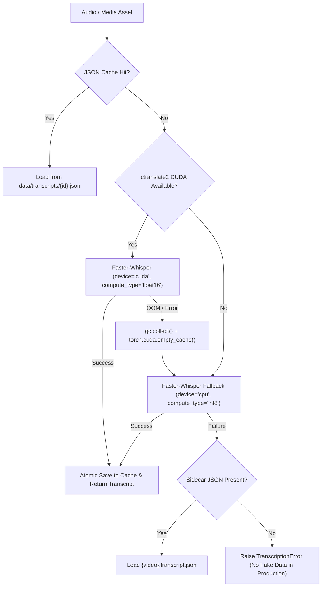
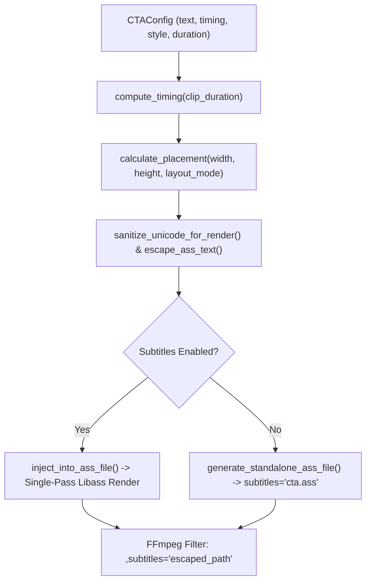
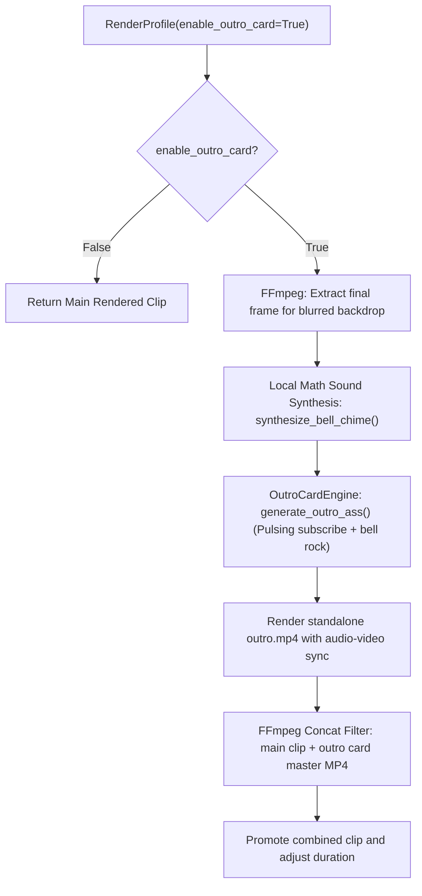

# YouTube Clipping Intelligence Platform - Permanent System Mental Map

## Architectural Reference, Execution Flow, and Call Hierarchy

---

## 1. Executive System Overview

The **YouTube Clipping Intelligence Platform (`yt-clipping-intelligence`)** is a production-grade, local-first intelligence and automated vertical clip generation pipeline. It autonomously discovers viral highlights, computes explainable multi-signal retention scores, trims dead air, synchronizes sub-second word timestamps, generates broadcast polish (hook onset, anti-pop fades, loop continuity), overlays self-contained animated Call-to-Action (CTA) lower-thirds, synthesizes dedicated animated outro cards with soft zen notification chimes, reframes widescreen footage into 9:16 vertical video using kinematic trajectory optimization, verifies media output integrity, and delivers clips via dual-mode autopost publishing.

```mermaid
graph TD
    User["Operator / CLI / MCP Client"] --> Entry["CLI / API Entry Point (yt-clip / master_cli.py)"]
    Entry --> Gate["Rights & Policy Verification Gate (LocalRightsPolicy)"]
    Gate --> Ingestion["Media Ingestion & Header Probe (LocalAssetProvider)"]
    Ingestion --> Transcribe["Speech Transcription & Word Alignment (LocalTranscriber / AlignmentEngine)"]
    Transcribe --> Detect["Candidate Segmentation & Narrative Arcs (ContextAwareSegmenter / ArcDetector)"]
    Detect --> Score["Explainable Scorecard & Heatmap Rerank (ExplainableScorecardScorer)"]
    Score --> Viability["Short Viability & Loop Hook Gate (ShortViabilityValidator)"]
    Viability --> Polish["Broadcast Hook Pacing & Dead-Air Micro-Cuts (DeadAirPruner)"]
    Polish --> Framing["Active Subject Kinematic Tracking (FaceFocusedFramer / TrajectoryOptimizer)"]
    Framing --> Render["FFmpeg Video Rendering & Compositing (FFmpegRenderer)"]
    Render --> CTA["Animated Lower-Third CTA & Libass Subtitles (CTAOverlayEngine)"]
    CTA --> Outro["Dedicated Outro Card & Soft Zen Chime (OutroCardEngine)"]
    Outro --> QA["Media Integrity & Probe Verification (MediaQualityVerifier)"]
    QA --> Publish["Dual-Mode Autopost Dispatcher (DualModeAutopostPublisher)"]
    Publish --> Journal["Persistent SQLite State Machine (JobJournal / SQLite)"]
```



---

## 2. Complete Repository Package Structure

```text
yt-clipping-intelligence/
├── pyproject.toml                     # Project packaging, CLI entry points, dependencies
├── pytest.ini                         # Test runner configuration (pythonpath = src .)
├── data/                              # Local-first persistence directories
│   ├── .gitkeep                       # Canonical git placeholder
│   ├── assets/                        # Downloaded/ingested source video media
│   ├── jobs.db                        # SQLite transactional state & metric snapshot database
│   ├── heatmaps/                      # Local JSON cache for YouTube replay heatmaps
│   ├── transcripts/                   # Word-level timestamp JSON transcripts
│   ├── rendered_clips/                # Atomic final rendered vertical 9:16 MP4s and manifests
│   └── rights_ledger.json             # Cryptographically verified rights manifest ledger
├── docs/                              # Technical system documentation & ADRs
│   ├── ARCHITECTURE.md                # Subsystem architecture & design principles
│   ├── CLI_REFERENCE.md               # Operator CLI command handbook (all 21 commands)
│   ├── MODULE_REFERENCE.md            # Public API, class, and method index across 14 packages
│   ├── PODCAST_ENGINE.md              # Multi-speaker podcast diarization & split-screen docs
│   ├── SYSTEM_MENTAL_MAP.md           # This document (permanent architectural mental map)
│   ├── REPOSITORY_AUDIT_REPORT.md     # Engineering audit and remediation record
│   └── mcp.md                         # Model Context Protocol stdio JSON-RPC 2.0 reference
├── src/yt_clipping/                   # Primary source codebase
│   ├── __init__.py                    # Top-level package exports (__version__, AppConfig)
│   ├── __main__.py                    # Package execution entry point
│   ├── config.py                      # Strongly-typed AppConfig and environment loader
│   ├── audio/                         # Edge-TTS voiceover synthesis
│   │   ├── __init__.py                # Package exports (TTSEngine)
│   │   └── tts_engine.py              # Local EdgeTTS and SAPI5 voice generator
│   ├── cli/                           # CLI commands and argparsing
│   │   ├── __init__.py                # Package exports (main, build_parser)
│   │   └── master_cli.py              # Master CLI parser (21 subcommands)
│   ├── contracts/                     # Canonical domain interfaces and data models
│   │   ├── __init__.py                # Package exports (Models, Enums, Interfaces, Errors)
│   │   ├── interfaces.py              # Abstract protocols (Transcriber, Renderer, Scorer, etc.)
│   │   └── models.py                  # Dataclass contracts (RenderProfile, HighlightCandidate, etc.)
│   ├── detection/                     # Segmentation, dead-air, and narrative turn analysis
│   │   ├── __init__.py                # Package exports (ArcDetector, Segmenter, Pruner, etc.)
│   │   ├── arc_detector.py            # Hook-anchored narrative arc detector
│   │   ├── audio_energy.py            # Acoustic RMS energy, motion, and cadence analyzer
│   │   ├── deadair.py                 # DeadAirPruner: micro-jump-cuts, filler word pruning
│   │   ├── dedupe.py                  # Highlight candidate IoU overlap suppression
│   │   ├── segmenter.py               # ContextAwareSegmenter: boundary detection & punctuation split
│   │   ├── sentence_classifier.py     # Linguistic sentence classification (HOOK, PAYOFF, SPONSOR)
│   │   └── short_viability.py         # ShortViabilityValidator: Survives Without Context rule
│   ├── discovery/                     # YouTube intelligence, trend analysis, and channel monitoring
│   │   ├── __init__.py                # Package exports (ChannelMonitor, OutlierMultiplier, etc.)
│   │   ├── attribution_engine.py      # Automated affiliate attribution generator
│   │   ├── channel_registry.py        # Creator channel metadata registry
│   │   ├── channel_watcher.py         # RSS / Atom feed polling watcher
│   │   ├── daemon.py                  # Multi-channel continuous background poll loop
│   │   ├── heatmap.py                 # HeatmapAnalyzer: YouTube replay curve & peak extraction
│   │   ├── monitor.py                 # Video candidate observation engine
│   │   ├── outlier.py                 # OutlierMultiplier: >=3.0x channel median breakout detection
│   │   ├── pinger_daemon.py           # High-velocity virality alert daemon
│   │   ├── quota_governor.py          # Daily YouTube API v3 quota tracker (10,000 units/day)
│   │   ├── ranker.py                  # PublicMetricRanker: recency decay, velocity score
│   │   ├── trend_analyzer.py          # Real-time virality calculator (views/hr, velocity ratio)
│   │   └── trend_scorer.py            # Scoring formula combining view velocity and resonance
│   ├── ingestion/                     # Asset acquisition and media stream probing
│   │   ├── __init__.py                # Package exports (LocalAssetProvider, extract_youtube_video_id)
│   │   └── asset_provider.py          # LocalAssetProvider: yt-dlp fetcher, ffprobe/OpenCV probe
│   ├── mcp/                           # Model Context Protocol stdio server
│   │   ├── __init__.py                # Package exports (MCPServer)
│   │   └── server.py                  # MCPServer: JSON-RPC 2.0 tools (inspect, trigger, publish)
│   ├── orchestration/                 # State machine, queue, and pipeline coordination
│   │   ├── __init__.py                # Package exports (ClippingPipeline, JobJournal, JobQueue)
│   │   ├── db.py                      # SQLite connection pooling and WAL mode management
│   │   ├── pipeline.py                # ClippingPipeline: 9-stage deterministic workflow
│   │   ├── queue.py                   # Priority job queue and concurrency governor
│   │   ├── state_machine.py           # JobJournal: immutable checkpoint ledger & resume engine
│   │   └── storage_manager.py         # Atomic file promotions and cache retention pruner
│   ├── podcast/                       # Multi-speaker podcast intelligence
│   │   ├── __init__.py                # Package exports (PodcastShortMaker, Diarizers, Layout)
│   │   ├── captions.py                # Split-screen centered word-synced ASS captions
│   │   ├── cli.py                     # Standalone podcast short maker CLI
│   │   ├── config.py                  # PodcastLayoutConfig (hybrid, stacked_always)
│   │   ├── diarization.py             # AcousticEnergyDiarizer (0MB VRAM) and Pyannote adapter
│   │   ├── layout.py                  # Split-screen and closeup FFmpeg filtergraphs
│   │   ├── pipeline.py                # PodcastShortMaker: director shot switching & render
│   │   └── shot_detector.py           # Visual shot classification (WIDE vs SINGLE_CLOSEUP)
│   ├── publisher/                     # Autopost publishing adapters
│   │   ├── __init__.py                # Package exports (DualModeAutopostPublisher)
│   │   └── adapter.py                 # DualModeAutopostPublisher: webhook & watched_folder modes
│   ├── qa/                            # Post-render quality assurance
│   │   ├── __init__.py                # Package exports (MediaQualityVerifier)
│   │   └── verifier.py                # MediaQualityVerifier: decodability, duration, black frames
│   ├── rendering/                     # Video composition, framing, and overlays
│   │   ├── __init__.py                # Package exports (FFmpegRenderer, OutroCardEngine, etc.)
│   │   ├── b_roll.py                  # BRollOverlayEngine: stock overlay & audio ducking
│   │   ├── captions.py                # SubtitleGenerator: kinetic ASS (hormozi, beast_bounce)
│   │   ├── cta_overlay.py             # CTAOverlayEngine: animated lower-third CTA banner
│   │   ├── face_tracker.py            # ConstrainedTrajectoryOptimizer & FaceFocusedFramer
│   │   ├── outro_card.py              # OutroCardEngine: animated outro & soft zen chime synthesis
│   │   ├── renderer.py                # FFmpegRenderer: 9:16 layout composition & anti-pop fades
│   │   └── subject_segmenter.py       # YOLOv8 subject boundary detection & segmentation
│   ├── reporting/                     # Executive telemetry reports
│   │   ├── __init__.py                # Package exports (ExecutiveReportGenerator)
│   │   └── html_report.py             # ExecutiveReportGenerator: standalone HTML scorecard reports
│   ├── rights/                        # Intellectual property & reuse gate
│   │   ├── __init__.py                # Package exports (LocalRightsPolicy)
│   │   └── gate.py                    # LocalRightsPolicy: license registry & eligibility gate
│   ├── scoring/                       # Candidate scoring & ranking
│   │   ├── __init__.py                # Package exports (ExplainableScorecardScorer, etc.)
│   │   ├── gemini_provider.py         # Optional Gemini Flash multimodal discovery adapter
│   │   ├── metadata_generator.py      # Title/description generator & hooks (ClipMetadata)
│   │   ├── packaging_linter.py        # Packaging title/caption linter (PackagingLinter)
│   │   └── scorecard.py               # ExplainableScorecardScorer: multi-signal retention formula
│   └── transcription/                 # Speech transcription and alignment
│       ├── __init__.py                # Package exports (LocalTranscriber, AlignmentEngine)
│       ├── alignment.py               # AlignmentEngine: FasterWhisper & WhisperX forced alignment
│       └── transcriber.py             # LocalTranscriber: local CUDA/CPU Int8 faster-whisper cascade
├── attribution_engine.py              # Root convenience entry point
├── channel_watcher.py                 # Root convenience entry point
├── pinger_daemon.py                   # Root convenience entry point
├── trend_scorer.py                    # Root convenience entry point
└── tests/                             # Full test suite (428 automated tests)
```

---

## 3. End-to-End Traceability Matrix: User Input to Rendered Output

```
CLI Argument:      --video-id VID --enable-cta --cta-style modern_pill --enable-outro-card
                        │
CLI Handler:       cmd_run() in src/yt_clipping/cli/master_cli.py
                        │
Orchestrator:      ClippingPipeline.process_video() in src/yt_clipping/orchestration/pipeline.py
                        │
Stage 1 (Rights):  LocalRightsPolicy.verify_rights() -> RightsManifest (Status: VERIFIED)
Stage 2 (Asset):   LocalAssetProvider.probe_asset() -> Probed media dimensions, codecs, SHA-256
Stage 3 (Speech):  LocalTranscriber.transcribe() -> Faster-Whisper (CUDA / Int8 CPU cascade)
Stage 4 (Segment): ContextAwareSegmenter.detect_candidates() -> List[HighlightCandidate]
Stage 5 (Scoring): ExplainableScorecardScorer.score_candidate() -> ScoreBreakdown & composite (0-100)
Stage 6 (Polish):  ShortViabilityValidator.validate_candidate() -> loop_affinity_score (0-100)
                   Stage 6b: Hook start trimmed to ~0.10s dead-air; outro mid-word protection
Stage 7 (Render):  FFmpegRenderer.render_clip() + CTAOverlayEngine + TrajectoryOptimizer
                   ├── Filtergraph: [0:v]crop=ih*9/16:ih:(iw-ow)/2:0,scale=1080:1920,fade=t=in...
                   ├── Audio: -af aresample=async=1,afade=t=in:ss=0:d=0.02,afade=t=out...
                   ├── Subtitles/CTA: subtitles='clip.ass' (Word highlights + animated CTA pill)
                   └── Outro Card (Optional): OutroCardEngine.render_outro_clip() + concat
                       └── Audio: Local math synthesis of soft zen notification chime (wave/struct)
Stage 8 (QA):      MediaQualityVerifier.verify_clip() -> QAReport (Duration, Stream, Audio, SHA256)
Stage 9 (Publish): DualModeAutopostPublisher.publish_clip() -> HandoffReceipt
                        │
Persistence:       JobJournal.record_stage_checkpoint() -> SQLite (jobs.db WAL mode)
```

---

## 4. Subsystem Mental Models

### 4.1 Strict Local-First Transcription & Alignment



### 4.2 Animated Call-to-Action (CTA) Overlay Engine



### 4.3 Dedicated Animated Outro Card & Local Sound Synthesis



**Synthesis Properties:**
- Pure Python mathematical synthesis using `math.sin`, `math.exp`, `wave`, and `struct`.
- Zero external APIs or cloud dependencies.
- `soft_zen` sound profile: C5 (523.25 Hz) fundamental + pure fifth (G5) harmonic + gentle octave decay.
- 30ms raised-cosine soft attack, mellow body, targeting ~ -12.5 dB peak amplitude.

---

## 5. Storage, State Machine, and Idempotency

All stages record progress in `data/jobs.db` via `JobJournal`:
- **Valid States (`JobStage`):**
  `DISCOVERED` $\rightarrow$ `RIGHTS_CHECKED` $\rightarrow$ `ASSET_INGESTED` $\rightarrow$ `TRANSCRIBED` $\rightarrow$ `SEGMENTED` $\rightarrow$ `SCORED` $\rightarrow$ `REVIEWED` $\rightarrow$ `RENDERED` $\rightarrow$ `QA_VERIFIED` $\rightarrow$ `HANDED_OFF` (or `FAILED`).
- **Atomic File Promotions:** Rendered clips are written to `.tmp.mp4` and promoted via `os.replace()` only after verifying file existence and non-zero byte size.
- **Resumption:** If a job fails or terminates, `ClippingPipeline.process_video()` queries `journal.get_job()` and resumes from the last validated checkpoint without re-transcribing or re-rendering completed assets.

---

## 6. Hardware Compatibility & Resource Constraints

| Hardware Configuration | Execution Target | Quantization | Maximum VRAM Allocated |
|---|---|---|---|
| NVIDIA GPU >= 4GB VRAM | CUDA | `float16` | ~2.5 GB (Faster-Whisper Base + YuNet) |
| Low-spec GPU / Laptop | CUDA / CPU Fallback | `int8` | < 1.5 GB |
| CPU-only Environment | Local CPU | `int8` (CTranslate2) | 0 MB VRAM (pure system RAM) |

---

## 7. CLI Command-to-Code Reference

| CLI Command | Handler Function | File Location | Key Arguments |
|---|---|---|---|
| `yt-clip autoprobe` | `cmd_autoprobe` | `src/yt_clipping/cli/master_cli.py` | `--channel`, `--render`, `--layout`, `--enable-cta`, `--enable-outro-card` |
| `yt-clip run` | `cmd_run` | `src/yt_clipping/cli/master_cli.py` | `--video-id`, `--layout`, `--enable-cta`, `--enable-outro-card` |
| `yt-clip preview` | `cmd_preview` | `src/yt_clipping/cli/master_cli.py` | `--video-id`, `--min-duration`, `--max-duration` |
| `yt-clip podcast` | `cmd_podcast` | `src/yt_clipping/cli/master_cli.py` | `--source`, `--out`, `--mode`, `--host-side`, `--enable-cta` |
| `yt-clip doctor` | `cmd_doctor` | `src/yt_clipping/cli/master_cli.py` | `--db` |
| `yt-clip config` | `cmd_config_validate` | `src/yt_clipping/cli/master_cli.py` | `validate` |
| `yt-clip cleanup` | `cmd_cleanup` | `src/yt_clipping/cli/master_cli.py` | `--days`, `--temp-only`, `--dry-run` |
| `yt-clip channels` | `cmd_channels` | `src/yt_clipping/cli/master_cli.py` | `add`, `list`, `remove` |
| `yt-clip daemon` | `cmd_daemon` | `src/yt_clipping/cli/master_cli.py` | `--interval`, `--max-iterations` |
| `yt-clip queue` | `cmd_queue` | `src/yt_clipping/cli/master_cli.py` | `status`, `--db` |
| `yt-clip dlq` | `cmd_dlq` | `src/yt_clipping/cli/master_cli.py` | `list`, `retry`, `--item-id` |
| `yt-clip quota` | `cmd_quota` | `src/yt_clipping/cli/master_cli.py` | `status`, `--db` |
| `yt-clip ingest` | `cmd_ingest` | `src/yt_clipping/cli/master_cli.py` | `--video-id`, `--ledger`, `--assets-dir` |
| `yt-clip rights` | `cmd_rights_register` / `cmd_rights_check` | `src/yt_clipping/cli/master_cli.py` | `register`, `check`, `--video-id`, `--basis` |
| `yt-clip tts` | `cmd_tts` | `src/yt_clipping/cli/master_cli.py` | `--text`, `--voice`, `--output` |
| `yt-clip jobs` | `cmd_jobs` | `src/yt_clipping/cli/master_cli.py` | `--status`, `--db` |
| `yt-clip discovery` | `cmd_discovery` | `src/yt_clipping/cli/master_cli.py` | `--channel-id`, `--views`, `--duration` |
| `yt-clip heatmap` | `cmd_heatmap` | `src/yt_clipping/cli/master_cli.py` | `--video-id`, `--visual`, `--cache-dir` |
| `yt-clip trends` | `cmd_trends` | `src/yt_clipping/cli/master_cli.py` | `--video-id`, `--chart`, `--region`, `--limit` |
| `yt-clip mcp-server` | `cmd_mcp_server` | `src/yt_clipping/cli/master_cli.py` | `--db`, `--output-dir`, `--log-level` |
| `yt-clip mcp serve` | `cmd_mcp_server` | `src/yt_clipping/cli/master_cli.py` | `--db`, `--output-dir`, `--log-level` |
