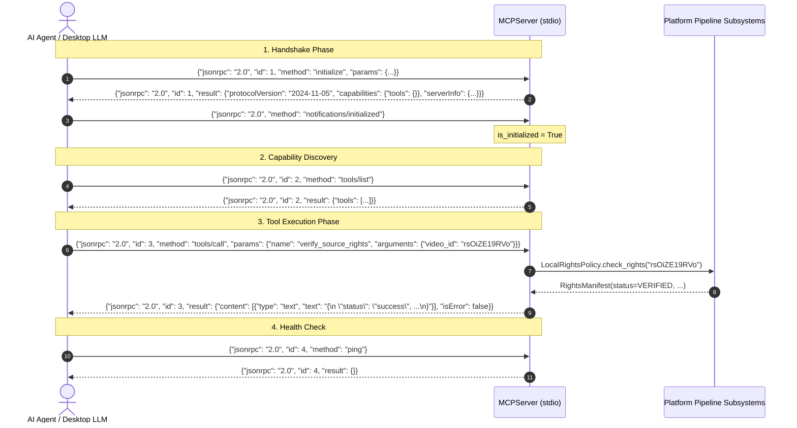

# Model Context Protocol (MCP) — Server Specification

Complete technical specification for the Model Context Protocol (MCP) JSON-RPC 2.0 stdio server embedded in the YouTube Clipping Intelligence Platform.

---

## 1. Overview & Protocol Conformance

The platform provides a native Model Context Protocol (MCP) server adhering to the official **`2024-11-05`** specification. It exposes the autonomous clipping pipeline as discrete, granular tools over a line-delimited JSON-RPC 2.0 stdio transport.

```text
┌────────────────────────────────┐         Line-Delimited JSON-RPC 2.0 (stdio)         ┌─────────────────────────────────┐
│       AI Client / Agent        │ ───────────────────────────────────────────────────► │          MCPServer              │
│ (Claude Desktop, Cursor, LLM)  │ ◄─────────────────────────────────────────────────── │   (yt-clipping-intelligence)   │
└────────────────────────────────┘                                                     └────────────────┬────────────────┘
                                                                                                        │
                                                                       ┌────────────────────────────────┼────────────────────────────────┐
                                                                       ▼                                ▼                                ▼
                                                            [ Discovery & Rights ]           [ Scoring & Heatmaps ]           [ Rendering & QA ]
```

### Server Metadata
- **Protocol Version:** `2024-11-05`
- **Server Name:** `yt-clipping-intelligence`
- **Server Version:** `1.0.0`
- **Transport:** Standard Input / Output (`stdin` / `stdout`), line-delimited UTF-8 JSON-RPC 2.0.
- **Stream Isolation Guarantee:** Diagnostic and operational logs are routed **strictly to `stderr`**. `stdout` is reserved exclusively for valid, single-line JSON-RPC frames. On Windows platforms, `stdin`, `stdout`, and `stderr` are explicitly reconfigured for UTF-8 encoding to prevent multibyte emoji or unicode character corruption.

---

## 2. Server Lifecycle & Framing

The server operates a persistent blocking message loop reading newline-separated (`\n`) JSON frames from `stdin`:



---

## 3. Error Codes & Handling Standard

The server implements strict JSON-RPC 2.0 error reporting. Protocol-level errors return standard top-level `error` envelopes, while application-level tool failures return `isError: true` inside the result payload with client-friendly diagnostics.

### Standard JSON-RPC 2.0 Error Codes
| Code | Error Type | Trigger Condition |
| :--- | :--- | :--- |
| **`-32700`** | Parse error | Received frame is not valid JSON. |
| **`-32600`** | Invalid Request | Payload is not a JSON object, or `method` is missing/not a string. |
| **`-32601`** | Method not found | The requested RPC method is not recognized (`initialize`, `ping`, `tools/list`, `tools/call`). |
| **`-32602`** | Invalid params | Missing tool `name` in `tools/call` parameters. |
| **`-32603`** | Internal error | Uncaught fatal exception in stdio framing loop. |

### Application-Level Tool Errors (`isError: true`)
When a requested tool encounters missing required arguments, non-existent assets, or downstream execution exceptions, it returns a 200 JSON-RPC response with `isError: true` to allow LLM agents to inspect the error and self-correct:
```json
{
  "jsonrpc": "2.0",
  "id": 105,
  "result": {
    "content": [
      {
        "type": "text",
        "text": "Error: Missing required argument 'video_id'"
      }
    ],
    "isError": true
  }
}
```

---

## 4. Complete Tool Catalog (7 Discrete Tools)

The MCP server exposes 7 discrete tool endpoints covering the entire clipping intelligence lifecycle:

| # | Tool Name | Scope | Primary Subsystem |
|---|---|---|---|
| 1 | `discover_channel_uploads` | Channel discovery & live video polling | `discovery/pinger_daemon.py` |
| 2 | `verify_source_rights` | Legal licensing & copyright compliance | `rights/gate.py`, `attribution_engine.py` |
| 3 | `analyze_replay_heatmap` | Audience retention & peak extraction | `discovery/heatmap.py` |
| 4 | `evaluate_highlight_candidates` | Highlight scoring (Heuristic / Gemini) | `scoring/scorecard.py`, `scoring/gemini_provider.py` |
| 5 | `render_vertical_clip` | 9:16 vertical video & subtitle rendering | `rendering/renderer.py`, `rendering/captions.py` |
| 6 | `inspect_job_status` | SQLite job journal & queue telemetry | `orchestration/state_machine.py`, `queue.py` |
| 7 | `list_available_tools` / `tools/list` | Tool catalog & parameter schemas | `mcp/server.py` |

---

### Tool 1: `discover_channel_uploads`

Discover recent video uploads from a YouTube creator channel using zero-quota RSS Atom feed polling with SQLite database caching.

#### Input Schema
```json
{
  "type": "object",
  "properties": {
    "channel_id": {
      "type": "string",
      "description": "YouTube Channel ID (e.g. UC...), handle (e.g. @hubermanlab), or channel URL"
    },
    "max_videos": {
      "type": "integer",
      "description": "Maximum number of recent uploads to return (default: 10)",
      "default": 10
    }
  },
  "required": ["channel_id"]
}
```

#### Example Request
```json
{
  "jsonrpc": "2.0",
  "id": 1,
  "method": "tools/call",
  "params": {
    "name": "discover_channel_uploads",
    "arguments": {
      "channel_id": "@hubermanlab",
      "max_videos": 2
    }
  }
}
```

#### Example Response
```json
{
  "jsonrpc": "2.0",
  "id": 1,
  "result": {
    "content": [
      {
        "type": "text",
        "text": "{\n  \"status\": \"success\",\n  \"channel_id\": \"UC2D2CMWXMOVWx7giW1n3LIg\",\n  \"channel_name\": \"Andrew Huberman\",\n  \"handle\": \"@hubermanlab\",\n  \"video_count\": 2,\n  \"videos\": [\n    {\n      \"video_id\": \"rsOiZE19RVo\",\n      \"title\": \"How to Optimize Your Brain & Dopamine\",\n      \"published_at\": \"2026-10-25T12:00:00Z\",\n      \"url\": \"https://www.youtube.com/watch?v=rsOiZE19RVo\",\n      \"channel_id\": \"UC2D2CMWXMOVWx7giW1n3LIg\",\n      \"channel_name\": \"Andrew Huberman\"\n    }\n  ]\n}"
      }
    ],
    "isError": false
  }
}
```

---

### Tool 2: `verify_source_rights`

Verify legal clipping authorization, fair-use status, and creator licensing policy for a video against the transactional SQLite rights ledger and creator attribution engine.

#### Input Schema
```json
{
  "type": "object",
  "properties": {
    "video_id": {
      "type": "string",
      "description": "YouTube 11-character video ID or full YouTube URL"
    },
    "policy_type": {
      "type": "string",
      "description": "Clipping rights policy filter: 'creator' (creator affiliate/permission), 'legal' (strict ledger grant), 'cc_by' (Creative Commons)",
      "default": "creator",
      "enum": ["creator", "legal", "cc_by"]
    }
  },
  "required": ["video_id"]
}
```

#### Example Request
```json
{
  "jsonrpc": "2.0",
  "id": 2,
  "method": "tools/call",
  "params": {
    "name": "verify_source_rights",
    "arguments": {
      "video_id": "rsOiZE19RVo",
      "policy_type": "creator"
    }
  }
}
```

#### Example Response
```json
{
  "jsonrpc": "2.0",
  "id": 2,
  "result": {
    "content": [
      {
        "type": "text",
        "text": "{\n  \"status\": \"success\",\n  \"video_id\": \"rsOiZE19RVo\",\n  \"can_process\": true,\n  \"rights_status\": \"VERIFIED\",\n  \"rights_basis\": \"OPEN_AFFILIATE\",\n  \"owner_name\": \"Andrew Huberman\",\n  \"creator_policy\": \"OPEN_AFFILIATE\",\n  \"is_safe_to_clip\": true,\n  \"audit_notes\": \"Verified affiliate clipping agreement registered.\",\n  \"attribution_required\": true\n}"
      }
    ],
    "isError": false
  }
}
```

---

### Tool 3: `analyze_replay_heatmap`

Extract and analyze the 100-point YouTube "Most Replayed" retention curve, identifying topological prominence peaks and optimal hook points.

#### Input Schema
```json
{
  "type": "object",
  "properties": {
    "video_id": {
      "type": "string",
      "description": "YouTube 11-character video ID"
    }
  },
  "required": ["video_id"]
}
```

#### Example Request
```json
{
  "jsonrpc": "2.0",
  "id": 3,
  "method": "tools/call",
  "params": {
    "name": "analyze_replay_heatmap",
    "arguments": {
      "video_id": "rsOiZE19RVo"
    }
  }
}
```

#### Example Response
```json
{
  "jsonrpc": "2.0",
  "id": 3,
  "result": {
    "content": [
      {
        "type": "text",
        "text": "{\n  \"status\": \"success\",\n  \"video_id\": \"rsOiZE19RVo\",\n  \"source\": \"youtube_markers\",\n  \"total_points\": 100,\n  \"peak_count\": 3,\n  \"global_peak\": {\n    \"time_seconds\": 142.5,\n    \"intensity\": 0.94,\n    \"prominence\": 0.38\n  },\n  \"peaks\": [\n    {\n      \"time_seconds\": 45.0,\n      \"intensity\": 0.81,\n      \"prominence\": 0.22\n    },\n    {\n      \"time_seconds\": 142.5,\n      \"intensity\": 0.94,\n      \"prominence\": 0.38\n    }\n  ]\n}"
      }
    ],
    "isError": false
  }
}
```

---

### Tool 4: `evaluate_highlight_candidates`

Detect and score candidate short-form highlights using local explainable heuristic intelligence or cloud multimodal Google Gemini Flash.

#### Input Schema
```json
{
  "type": "object",
  "properties": {
    "video_id": {
      "type": "string",
      "description": "YouTube 11-character video ID"
    },
    "engine": {
      "type": "string",
      "description": "Evaluation intelligence engine: 'heuristic' (local explainable scorecard) or 'gemini' (Gemini 1.5 Flash cloud provider)",
      "default": "heuristic",
      "enum": ["heuristic", "gemini"]
    }
  },
  "required": ["video_id"]
}
```

#### Example Request
```json
{
  "jsonrpc": "2.0",
  "id": 4,
  "method": "tools/call",
  "params": {
    "name": "evaluate_highlight_candidates",
    "arguments": {
      "video_id": "rsOiZE19RVo",
      "engine": "heuristic"
    }
  }
}
```

#### Example Response
```json
{
  "jsonrpc": "2.0",
  "id": 4,
  "result": {
    "content": [
      {
        "type": "text",
        "text": "{\n  \"status\": \"success\",\n  \"video_id\": \"rsOiZE19RVo\",\n  \"engine_used\": \"heuristic\",\n  \"candidate_count\": 1,\n  \"candidates\": [\n    {\n      \"candidate_id\": \"cand-rsOiZE19RVo-135_180\",\n      \"start_seconds\": 135.0,\n      \"end_seconds\": 180.0,\n      \"duration_seconds\": 45.0,\n      \"score\": 88.5,\n      \"hook_title\": \"The Dopamine Wave You Never Knew Existed\",\n      \"suggested_description\": \"How to master your dopamine baseline daily. #shorts #focus\",\n      \"transcript_text\": \"When you experience a dopamine peak, your baseline actually drops...\",\n      \"breakdown\": {\n        \"hook_score\": 9.2,\n        \"moment_score\": 8.8,\n        \"coherence_score\": 8.5,\n        \"pacing_score\": 8.6,\n        \"heatmap_score\": 9.4\n      }\n    }\n  ]\n}"
      }
    ],
    "isError": false
  }
}
```

---

### Tool 5: `render_vertical_clip`

Render a vertical 9:16 short clip from source video media with kinetic word-level subtitles, reframing filtergraphs, and optional stacked multi-speaker layout.

#### Input Schema
```json
{
  "type": "object",
  "properties": {
    "video_id": {
      "type": "string",
      "description": "YouTube 11-character video ID"
    },
    "start_sec": {
      "type": "number",
      "description": "Clip start timestamp in seconds"
    },
    "end_sec": {
      "type": "number",
      "description": "Clip end timestamp in seconds"
    },
    "layout": {
      "type": "string",
      "description": "Visual layout format: 'blur_background', 'active_speaker', 'split_screen' / 'stacked', 'crop_center'",
      "default": "stacked",
      "enum": ["stacked", "split_screen", "blur_background", "crop_center", "active_speaker"]
    },
    "preset": {
      "type": "string",
      "description": "Kinetic subtitle aesthetic preset: 'hormozi', 'beast_bounce', 'neon_cyber', 'karaoke_gold', 'bold_social', 'podcast'",
      "default": "hormozi",
      "enum": ["hormozi", "beast_bounce", "neon_cyber", "karaoke_gold", "bold_social", "podcast"]
    }
  },
  "required": ["video_id", "start_sec", "end_sec"]
}
```

#### Example Request
```json
{
  "jsonrpc": "2.0",
  "id": 5,
  "method": "tools/call",
  "params": {
    "name": "render_vertical_clip",
    "arguments": {
      "video_id": "rsOiZE19RVo",
      "start_sec": 135.0,
      "end_sec": 180.0,
      "layout": "active_speaker",
      "preset": "hormozi"
    }
  }
}
```

#### Example Response
```json
{
  "jsonrpc": "2.0",
  "id": 5,
  "result": {
    "content": [
      {
        "type": "text",
        "text": "{\n  \"status\": \"success\",\n  \"video_id\": \"rsOiZE19RVo\",\n  \"clip_id\": \"clip-mcp-rsOiZE19RVo-135_180\",\n  \"output_file\": \"C:\\\\yt-clipping\\\\data\\\\rendered_clips\\\\clip-mcp-rsOiZE19RVo-135_180.mp4\",\n  \"duration_seconds\": 45.0,\n  \"width\": 1080,\n  \"height\": 1920,\n  \"file_size_bytes\": 14892300,\n  \"sha256\": \"e3b0c44298fc1c149afbf4c8996fb92427ae41e4649b934ca495991b7852b855\",\n  \"layout_applied\": \"active_speaker\",\n  \"subtitle_preset_applied\": \"hormozi\"\n}"
      }
    ],
    "isError": false
  }
}
```

---

### Tool 6: `inspect_job_status`

Inspect execution status, checkpoints, and QA verification telemetry for a specific pipeline job or the entire SQLite queue.

#### Input Schema
```json
{
  "type": "object",
  "properties": {
    "job_id": {
      "type": "string",
      "description": "Canonical job ID (e.g. 'job-xyz-123') or 'all'/'queue' for general queue metrics"
    }
  },
  "required": ["job_id"]
}
```

#### Example Request
```json
{
  "jsonrpc": "2.0",
  "id": 6,
  "method": "tools/call",
  "params": {
    "name": "inspect_job_status",
    "arguments": {
      "job_id": "job-rsOiZE19RVo-9a8b7c6d"
    }
  }
}
```

#### Example Response
```json
{
  "jsonrpc": "2.0",
  "id": 6,
  "result": {
    "content": [
      {
        "type": "text",
        "text": "{\n  \"status\": \"success\",\n  \"job_id\": \"job-rsOiZE19RVo-9a8b7c6d\",\n  \"video_id\": \"rsOiZE19RVo\",\n  \"current_stage\": \"QA_VERIFIED\",\n  \"status_value\": \"SUCCEEDED\",\n  \"retry_count\": 0,\n  \"max_retries\": 3,\n  \"checkpoints\": {\n    \"transcription\": {\"engine\": \"faster-whisper\", \"words\": 1240},\n    \"alignment\": {\"engine\": \"faster-whisper\", \"status\": \"MONOTONIC\"},\n    \"qa_verification\": {\"sar\": \"1:1\", \"dar\": \"9:16\", \"status\": \"PASSED\"}\n  },\n  \"error_message\": null,\n  \"created_at\": \"2026-11-01T12:00:00Z\",\n  \"updated_at\": \"2026-11-01T12:02:15Z\"\n}"
      }
    ],
    "isError": false
  }
}
```

---

### Tool 7: `list_available_tools` (`tools/list`)

Returns complete JSON schemas for all registered tools, enabling dynamic schema discovery by LLM agents.

#### Example Request
```json
{
  "jsonrpc": "2.0",
  "id": 7,
  "method": "tools/list"
}
```

#### Example Response
```json
{
  "jsonrpc": "2.0",
  "id": 7,
  "result": {
    "tools": [
      {
        "name": "discover_channel_uploads",
        "description": "Discover recent video uploads from a YouTube creator channel via zero-quota RSS Atom feed parser and monitored channel registry.",
        "inputSchema": { "type": "object", "properties": { ... }, "required": ["channel_id"] }
      },
      ...
    ]
  }
}
```

---

## 5. CLI Invocation & Operating Modes

The MCP server can be launched via standard CLI commands:

```bash
# Direct execution via master CLI
python -m yt_clipping.cli.master_cli mcp-server

# Alternative subcommand alias
python -m yt_clipping.cli.master_cli mcp serve

# When installed as a package
yt-clip mcp-server
```

### CLI Parameters
| Flag | Default | Description |
| :--- | :--- | :--- |
| `--db` | `data/jobs.db` | Path to SQLite WAL jobs database. |
| `--assets-dir` | `data/assets` | Directory containing downloaded source media. |
| `--transcripts-dir` | `data/transcripts` | Directory containing JSON transcripts. |
| `--output-dir` | `data/rendered_clips` | Destination directory for rendered 9:16 clips. |
| `--log-level` | `INFO` | Stderr logging verbosity (`DEBUG`, `INFO`, `WARNING`, `ERROR`). |

---

## 6. Desktop LLM Client Integration

### Claude Desktop (`claude_desktop_config.json`)
To enable Anthropic's Claude Desktop app to autonomously discover videos, score moments, and render clips:

```json
{
  "mcpServers": {
    "yt-clipping": {
      "command": "python",
      "args": [
        "-m",
        "yt_clipping.cli.master_cli",
        "mcp-server",
        "--db",
        "C:\\Users\\username\\yt-clipping-intelligence\\data\\jobs.db",
        "--output-dir",
        "C:\\Users\\username\\yt-clipping-intelligence\\data\\rendered_clips"
      ],
      "cwd": "C:\\Users\\username\\yt-clipping-intelligence"
    }
  }
}
```

### Python Subprocess Integration
```python
import subprocess
import json

proc = subprocess.Popen(
    ["python", "-m", "yt_clipping.cli.master_cli", "mcp-server"],
    stdin=subprocess.PIPE,
    stdout=subprocess.PIPE,
    stderr=subprocess.PIPE,
    text=True,
    encoding="utf-8"
)

# Send initialize
req = {"jsonrpc": "2.0", "id": 1, "method": "initialize", "params": {}}
proc.stdin.write(json.dumps(req) + "\n")
proc.stdin.flush()

response = json.loads(proc.stdout.readline())
print("MCP Server Initialized:", response["result"]["serverInfo"])
```
