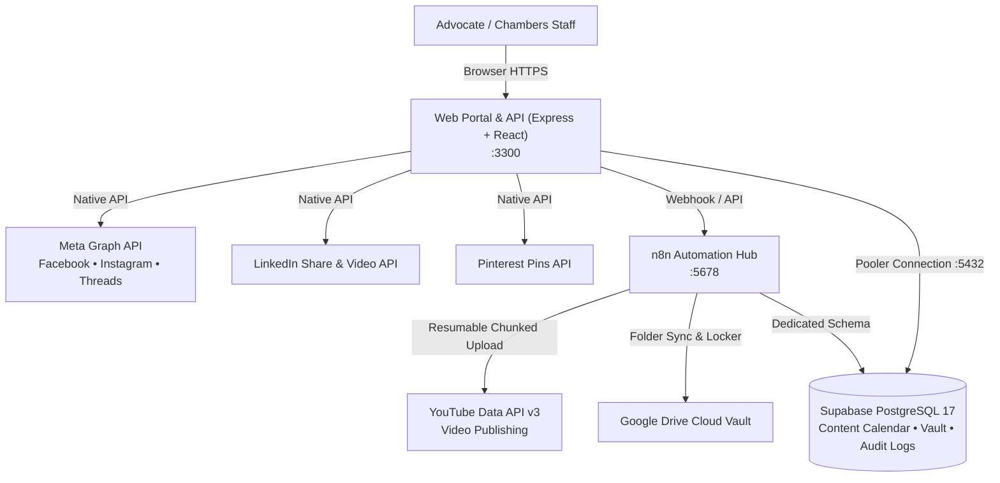

# 🚀 OmniPost — Universal Social Media Automation & Video Publishing Engine

> Complete standalone platform for uploading, scheduling, and automatically publishing videos and multi-format content across **YouTube, Facebook, Instagram, Threads, LinkedIn, and Pinterest**, wireable to any website, CMS, or application.

[](https://nodejs.org/)
[](https://react.dev/)
[](https://expressjs.com/)
[](https://n8n.io/)
[](https://supabase.com/)
[](https://www.docker.com/)
[](https://render.com/)

---

## 📑 Table of Contents

1. [Architecture Overview](#-architecture-overview)
2. [Key Capabilities](#-key-capabilities)
3. [Repository Directory Structure](#-repository-directory-structure)
4. [Quick Start (Local Development)](#-quick-start-local-development)
   - [Option A: One-Click Docker Compose (Recommended)](#option-a-one-click-docker-compose-recommended)
   - [Option B: Native Node.js & Vite](#option-b-native-nodejs--vite)
5. [Channel Integrations & Social APIs](#-channel-integrations--social-apis)
   - [1. YouTube Data API v3 & Video Uploader](#1-youtube-data-api-v3--video-uploader)
   - [2. Meta Graph API (Facebook, Instagram & Threads)](#2-meta-graph-api-facebook-instagram--threads)
   - [3. LinkedIn Community Management API](#3-linkedin-community-management-api)
   - [4. Pinterest Marketing API v5](#4-pinterest-marketing-api-v5)
6. [Database Setup (Supabase PostgreSQL)](#-database-setup-supabase-postgresql)
7. [n8n Automation Engine](#-n8n-automation-engine)
8. [Role-Based Access Control (RBAC)](#-role-based-access-control-rbac)
9. [Production Deployment](#-production-deployment)
   - [Render ($0/mo Free Tier Blueprint)](#1-render-free-tier-blueprint)
   - [Self-Hosted VPS (Docker + Caddy / Nginx)](#2-self-hosted-vps-docker--caddy--nginx)
   - [Automated Publishing Cron (GitHub Actions)](#3-automated-publishing-cron-github-actions)
10. [Automated Testing Suite](#-automated-testing-suite)

---

## 🏛️ Architecture Overview

The suite is engineered as a clean, microservices-ready system with **two containerized services**:
1. **Advocate Web Portal (`web/`)**: React + Vite frontend bundled and served by an Express backend on port `3300`. It houses the Content Composer, Media Uploader, Calendar Stream, Native Publishing Adapters, and the Client Vault API.
2. **n8n Workflow Hub (`n8n/`)**: Headless workflow runner on port `5678` executing YouTube resumable uploads, Google Drive document synchronization, content approval webhooks, and AI agent prompts.



---

## 🌟 Key Capabilities

### 🎥 Multi-Platform Video & Post Publisher
- **Direct Video Uploading**: Upload legal explainer videos (`.mp4`, `.mov`) directly through the dashboard with live upload progress.
- **Resumable YouTube Video Pipeline**: Dedicated n8n workflow supporting large video files with chunked resumable upload protocols, custom titles, tags, privacy settings, and video playlists.
- **Native Social Adapters**: Zero heavyweight third-party SaaS dependencies. Native HTTP adapters directly communicate with official developer APIs:
  - **Facebook Pages**: Feed video & image publishing with page tokens.
  - **Instagram Professional**: Video reels and carousel publishing via Graph container endpoints.
  - **Threads**: Automated text and media threads publishing.
  - **LinkedIn**: UGC posts and native video registration.
  - **Pinterest**: Pin creation with destination links and board selectors.

### ✍️ Intelligent Content Composer
- **Real-Time Previews**: Instant visual preview cards mimicking actual Facebook, Instagram, LinkedIn, and YouTube post layouts.
- **Live Limit Indicators**: Real-time character counts, hashtag counters, and platform warning badges before submitting.
- **Timezone-Aware Scheduling**: Schedule posts in `Asia/Kolkata` (IST) or publish immediately with 1-click override.

### 🔒 Role-Separated Security & Legal Privilege
- **Privileged Chambers Vault**: Completely isolated client will submissions, confidential notes, and sensitive estate planning assets.
- **Strict Role Keys**:
  - `CHAMBERS_ADMIN_SECRET_KEY`: Complete access to client legal vault, document approvals, and social publishing.
  - `AUTOMATION_SECRET_KEY`: Restricts social media assistants exclusively to content drafting and post scheduling.

---

## 🗂️ Repository Directory Structure

```text
advocate-social-automation-suite/
│
├── web/                           # 🌐 Video Posting Portal & Express Backend API
│   ├── src/                       # React 18 UI components
│   │   ├── components/            # ContentComposer, UploaderModule, PostCard, Feed, etc.
│   │   ├── App.jsx                # Single Page Application root
│   │   ├── main.jsx               # React entry point
│   │   └── index.css              # Tailwind styling & tokens
│   ├── publishing/                # 🚀 Native Social Media Publishing Engines
│   │   ├── registry.js            # Unified channel registry & requirements
│   │   ├── preflight.js           # Media, aspect ratio & caption validation
│   │   ├── schedule.js            # Cron schedule & due posts selector
│   │   ├── state.js               # Post state transitions (draft -> queued -> published)
│   │   ├── classify.js            # Transient vs terminal error classifier
│   │   ├── meta.js                # Facebook, Instagram & Threads Graph API adapter
│   │   ├── linkedin.js            # LinkedIn Share & Video API adapter
│   │   ├── pinterest.js           # Pinterest Pins & Boards API adapter
│   │   └── *.test.mjs             # 68 automated unit & integration tests
│   ├── server.js                  # Express API server & static asset host
│   ├── auth.js                    # Dual-passkey RBAC authentication
│   ├── db.js                      # Supabase Postgres database client
│   ├── drive-sync.js              # Google Drive integration
│   ├── Dockerfile                 # Multi-stage production container build (Node 24 Alpine)
│   ├── package.json               # Dependencies and runner scripts
│   └── vite.config.js             # Vite configuration
│
├── n8n/                           # 🤖 n8n Workflow Automation Engine
│   ├── README.md                  # Workflow configuration instructions
│   ├── NATIVE_PUBLISHING_BLUEPRINT.md # Publishing design guide
│   ├── SOCIAL_API_REFERENCE.md    # API reference documentation
│   └── claude_mcp/                # Production workflow JSON templates
│       ├── YouTube_Publisher.json # Resumable YouTube video upload workflow
│       ├── Content_Ingestion_Webhook.json # Instant post webhook trigger
│       ├── Content_Approval_Requests.json # Email approval pipeline
│       └── Will_Document_Ingestion.json   # Google Drive intake pipeline
│
├── supabase/                      # 🗄️ Database Schemas & Migrations
│   ├── schema.sql                 # Content calendar, posts & publishing history
│   ├── n8n-schema.sql             # Isolated schema for n8n internal tables
│   ├── rbac.sql                   # Row Level Security (RLS) policies
│   ├── 001_client_auth_and_portal.sql # Client profile and authentication schema
│   ├── supabase-root-2021-ca.crt  # SSL CA Certificate for secure database pooler
│   └── apply-migration.mjs        # Migration execution script
│
├── deploy/                        # 🚀 Production Server Configs
│   ├── Caddyfile                  # Automatic TLS reverse proxy template
│   ├── nginx.conf                 # Nginx reverse proxy template
│   ├── DNS_AND_DOMAINS.md         # Domain routing & DNS records guide
│   └── README-render.md           # Render hosting documentation
│
├── scripts/                       # 🛠️ Operational & Verification Scripts
│   ├── validate-4-channels.mjs    # Validates active API connections
│   ├── test-meta-publishing.mjs   # Meta Graph API smoke test
│   └── organize-drive-folders.js  # Google Drive folder restructuring
│
├── .github/workflows/             # ⚙️ GitHub Actions Automation
│   ├── publish-cron.yml           # Scheduled tick trigger for due posts
│   └── keep-alive.yml             # Health check & warm-up runner
│
├── docker-compose.yml             # Local / VPS multi-container orchestration
├── docker-compose.prod.yml        # Production Docker configuration
├── render.yaml                    # One-Click Render Blueprint ($0 free tier)
├── service-manager.ps1            # PowerShell interactive service controller
├── start-all.bat                  # 1-Click Windows startup launcher
├── stop-all.bat                   # 1-Click Windows shutdown launcher
├── status.bat                     # 1-Click service health check
├── .env.example                   # Master environment configuration template
├── QUICKSTART.md                  # 5-minute setup guide
└── README.md                      # This master documentation
```

---

## ⚡ Quick Start (Local Development)

### Prerequisites
- [Node.js](https://nodejs.org/) (version 22 or 24 LTS)
- [Docker Desktop](https://www.docker.com/) (if running containerized)

### Step 1: Configure Environment Variables
Copy `.env.example` to `.env`:
```bash
cp .env.example .env
```
Open `.env` and configure:
- `CHAMBERS_ADMIN_SECRET_KEY`: Set a secure passkey for the legal portal (e.g. `openssl rand -base64 32`)
- `AUTOMATION_SECRET_KEY`: Set a secure passkey for social media scheduling
- `N8N_ENCRYPTION_KEY`: Set a 32-byte hex key for n8n credentials (e.g. `openssl rand -hex 32`)

---

### Option A: One-Click Docker Compose (Recommended)

Run on Windows:
```cmd
double-click start-all.bat
```
Or run directly from terminal:
```bash
docker compose up -d --build
```

**Services will be live at:**
- **Advocate Web Portal**: [http://localhost:3300](http://localhost:3300)
- **n8n Workflow Hub**: [http://localhost:5678](http://localhost:5678)
- **Health Check**: [http://localhost:3300/api/health](http://localhost:3300/api/health)

To stop the services:
```cmd
double-click stop-all.bat
```

---

### Option B: Native Node.js & Vite

Run the web portal directly on your host without Docker:
```bash
cd web
npm install
npm run dev
```
This boots:
- Express Backend API on `http://localhost:3300`
- Vite React Client on `http://localhost:5173` (with `/api` proxy to `:3300`)

---

## 📡 Channel Integrations & Social APIs

The suite publishes natively to all channels without recurring third-party SaaS subscriptions.

### 1. YouTube Data API v3 & Video Uploader
- **Workflow File**: [`n8n/claude_mcp/YouTube_Publisher.json`](n8n/claude_mcp/YouTube_Publisher.json)
- **Method**: Google Cloud OAuth 2.0 with scopes:
  - `https://www.googleapis.com/auth/youtube.upload`
  - `https://www.googleapis.com/auth/youtube`
- **Features**: Resumable multi-part upload protocol, custom title formatting, category assignment (e.g. Education/Legal), and privacy statuses (`public`, `unlisted`, `private`).

### 2. Meta Graph API (Facebook, Instagram & Threads)
- **Adapter File**: [`web/publishing/meta.js`](web/publishing/meta.js)
- **API Version**: Graph API `v21.0`
- **Required Tokens in `.env`**:
  ```env
  FACEBOOK_PAGE_ID=your_page_id
  FACEBOOK_PAGE_ACCESS_TOKEN=your_never_expiring_page_token
  INSTAGRAM_BUSINESS_ACCOUNT_ID=your_ig_business_id
  THREADS_USER_ID=your_threads_id
  THREADS_ACCESS_TOKEN=your_threads_long_lived_token
  ```
- **Validation**: Test your Meta connection anytime:
  ```bash
  node scripts/test-meta-accounts.mjs
  ```

### 3. LinkedIn Community Management API
- **Adapter File**: [`web/publishing/linkedin.js`](web/publishing/linkedin.js)
- **Required Tokens in `.env`**:
  ```env
  LINKEDIN_ACCESS_TOKEN=your_oauth2_token
  LINKEDIN_AUTHOR_URN=urn:li:person:YOUR_ID or urn:li:organization:YOUR_ORG_ID
  ```
- **Features**: Publishes UGC shares and registers direct video uploads via LinkedIn Assets API.

### 4. Pinterest Marketing API v5
- **Adapter File**: [`web/publishing/pinterest.js`](web/publishing/pinterest.js)
- **Required Tokens in `.env`**:
  ```env
  PINTEREST_ACCESS_TOKEN=pina_your_token
  PINTEREST_BOARD_ID=your_board_id
  ```

---

## 🗄️ Database Setup (Supabase PostgreSQL)

The platform uses Supabase PostgreSQL 17 for persistent storage:
1. Open your Supabase Dashboard -> **SQL Editor**.
2. Run [`supabase/schema.sql`](supabase/schema.sql) to create:
   - `content_calendar`: Stores drafts, queued posts, media URLs, scheduled timestamps, and target networks.
   - `publishing_history`: Audit trail recording HTTP status codes, post URLs, and error diagnostics.
   - `will_submissions`: Confidential legal intake records.
3. Run [`supabase/n8n-schema.sql`](supabase/n8n-schema.sql) to create the isolated `n8n` schema for n8n's internal execution state.
4. Run [`supabase/rbac.sql`](supabase/rbac.sql) to apply Row Level Security policies.

---

## 🤖 n8n Automation Engine

n8n runs headlessly as the workflow integration engine:
1. Access n8n at `http://localhost:5678` (or your production URL).
2. Create an admin user on first launch.
3. Navigate to **Workflows** -> **Import from File**.
4. Import the pre-built workflows located in [`n8n/claude_mcp/`](n8n/claude_mcp/):
   - `YouTube_Publisher.json`
   - `Content_Ingestion_Webhook.json`
   - `Content_Approval_Requests.json`
5. Connect your Google OAuth credential in n8n for YouTube.

---

## 🔒 Role-Based Access Control (RBAC)

To safeguard confidential client legal matters from marketing personnel, access is partitioned into two distinct keys:

| Key | Permissions | Accessible Routes |
|---|---|---|
| `CHAMBERS_ADMIN_SECRET_KEY` | **Full Superset** | Legal client vault (`/portal`), will submissions, payments, and social media publishing. |
| `AUTOMATION_SECRET_KEY` | **Publishing Only** | Content composer, video uploader, scheduled posts, and channel status. Cannot view client PII. |

Pass the key via the HTTP header:
```http
X-Admin-Key: <your_secret_key>
```
Or use the login screen in the web portal.

---

## 🚀 Production Deployment

### 1. Render ($0 Free Tier Blueprint)
The repository includes a battle-tested [`render.yaml`](render.yaml) configured specifically for Render's free tier:
- Sized for **512 MB RAM limits** (includes Node.js heap capping `--max-old-space-size=256`).
- Deploys two zero-cost services: `advocate-content-portal` and `n8n-automation`.
- Automated health probes prevent restart loops during cold starts.

**To Deploy on Render:**
1. Push this folder to your GitHub repository.
2. Log into [Render Dashboard](https://dashboard.render.com/) -> **New** -> **Blueprint**.
3. Connect your repository. Render automatically reads `render.yaml`.
4. Enter your secret environment variables in the Render dashboard and deploy!

### 2. Self-Hosted VPS (Docker + Caddy / Nginx)
Templates for VPS deployment with automated HTTPS certificates are provided in [`deploy/`](deploy/):
- **Caddy**: Use [`deploy/Caddyfile`](deploy/Caddyfile) for automatic Let's Encrypt SSL.
- **Nginx**: Use [`deploy/nginx.conf`](deploy/nginx.conf) for standard reverse proxy setups.

### 3. Automated Publishing Cron (GitHub Actions)
Since Render free tier cron jobs are paid, a free GitHub Actions workflow is provided:
- [`.github/workflows/publish-cron.yml`](.github/workflows/publish-cron.yml): Triggers every 15 minutes to prompt the portal to publish any posts whose scheduled time has arrived.

---

## 🧪 Automated Testing Suite

The suite comes with **68 automated tests** covering security, publishing logic, and API adapters:
```bash
cd web
npm test
```

### Verified Test Categories:
- **RBAC Security Suite**: Ensures automation keys cannot access client wills; timing-safe key comparison.
- **Publishing Adapters**: Preflight media size and aspect-ratio validation.
- **Batching & Idempotency**: Duplicate prevention; partial failure resilience.
- **Schedule Engine**: Correctness under UTC vs IST (`Asia/Kolkata`) timezone transformations.
- **Drive Sync**: Folder provisioning and document attachment integrity.

---

## 🌐 Universal REST API v1 (Wire to Any Platform, App, or CMS)

This automation suite provides a generic, platform-agnostic REST API. Any external website (WordPress, Webflow, Shopify), mobile app, or webhook service can dispatch and schedule posts through this engine.

### API Authentication
Pass your automation secret key in either header:
- `X-Admin-Key: <AUTOMATION_SECRET_KEY>`
- `Authorization: Bearer <AUTOMATION_SECRET_KEY>`

### Endpoints Reference

| Method | Endpoint | Description |
|---|---|---|
| `GET` | `/api/config` | Brand configuration, theme titles, hashtags, and feature toggles |
| `GET` | `/api/v1/channels` | Status and health of configured social network drivers |
| `POST` | `/api/v1/publish` | Instantly publish a post with media across multiple platforms |
| `POST` | `/api/v1/schedule` | Schedule a future post with ISO 8601 timestamp |
| `GET` | `/api/v1/posts` | Query post calendar, feed, and publication status history |

### Example cURL: Instant Multi-Platform Publish
```bash
curl -X POST https://your-automation-host.com/api/v1/publish \
  -H "Content-Type: application/json" \
  -H "X-Admin-Key: secret_key_here" \
  -d '{
    "title": "New Product Update",
    "caption": "Excited to share what we built this week! #Tech #Launch",
    "mediaUrl": "https://cdn.example.com/videos/demo.mp4",
    "platforms": {
      "youtube": true,
      "facebook": true,
      "instagram": true,
      "linkedin": true,
      "threads": true
    }
  }'
```

---

## 📄 License & Intellectual Property

Proprietary software developed for **OmniPost** (Advocates & Legal Consultants, Kavali, Andhra Pradesh). All rights reserved.
